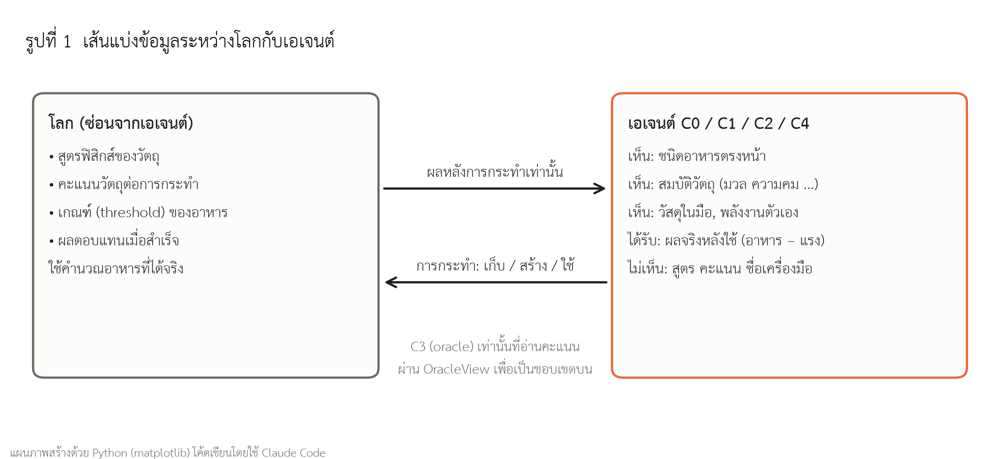
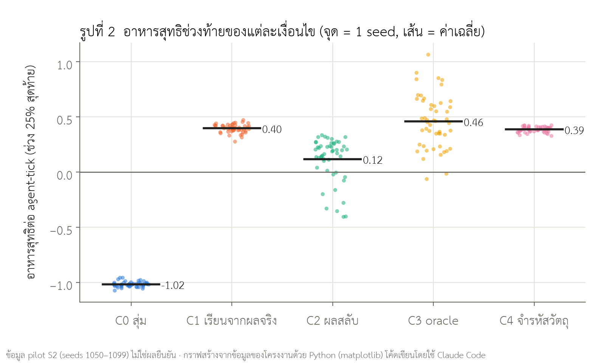
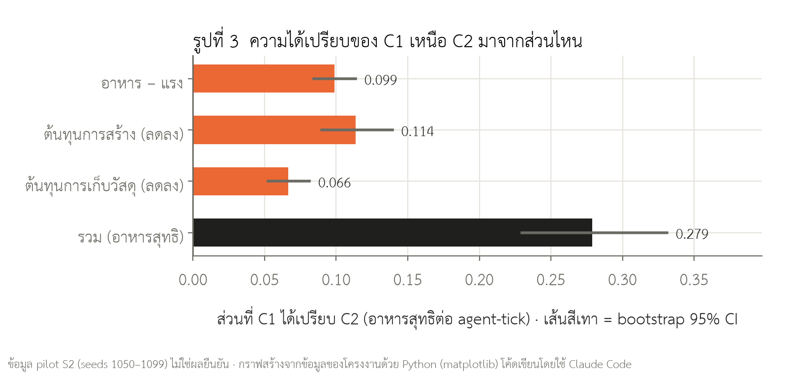
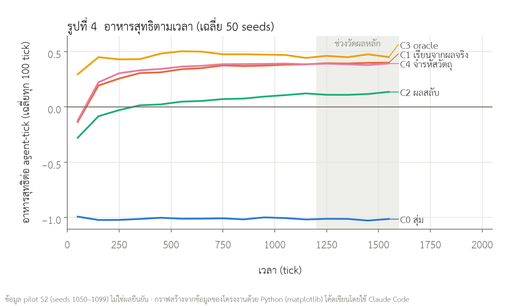
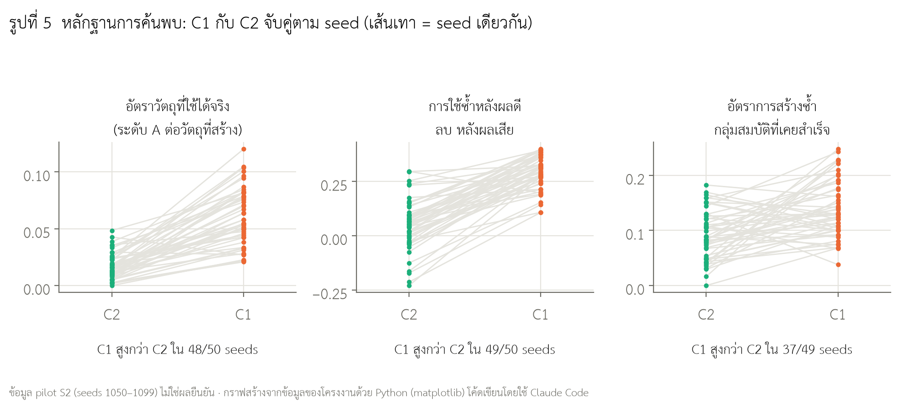

> **หมายเหตุฉบับร่าง (ลบออกก่อนส่ง)**
> ร่าง 14 ต.ค. 2569 · บทผลการทดลอง (หัวข้อ 11) ใช้ **ข้อมูล pilot** (seeds 1050–1099) ทั้งหมด ยังไม่ใช่ผลการทดลองยืนยัน
> ตำแหน่งที่ต้องเติมหลังรันยืนยัน (seeds 5000–5049 ตาม `docs/ysc2027_tool_discovery/05_confirmatory_protocol.md`) มีป้าย **[รอผลยืนยัน]** กำกับไว้ทุกจุด
> ก่อนส่งต้องเปลี่ยนบทคัดย่อ บทผล และบทสรุปให้ใช้ผลยืนยัน และลบป้าย "ข้อมูล pilot" ออกจากข้อความที่ไม่ใช่ส่วนรายงาน pilot

---

<div align="center">

**รายงานฉบับสมบูรณ์**
**โครงการแข่งขันพัฒนาโครงงานของนักวิทยาศาสตร์รุ่นเยาว์ ครั้งที่ 29 (YSC 2027)**

รหัสโครงการ **29YCSS00443**

**การค้นพบเครื่องมือเชิงหน้าที่ของเอเจนต์ประดิษฐ์ด้วยการลองผิดลองถูก
โดยไม่มีสูตรสำเร็จหรือข้อมูลประโยชน์ล่วงหน้า**

**Emergent Functional Tool Discovery by Artificial Agents Through Trial and Error
Without Recipes or Prior Utility Information**

สาขาหลัก: วิทยาการคอมพิวเตอร์ (Computer Science: CS)
สาขาย่อย: ปัญญาประดิษฐ์และการเรียนรู้ของเครื่อง (Artificial Intelligence and Machine Learning)

ผู้พัฒนาโครงงาน
นายชิษณุพงศ์ อินทร์จันทร์ (Chisanupong Injun) ชั้นมัธยมศึกษาปีที่ 4

อาจารย์ที่ปรึกษา
นายบพิธ มังคะลา (Bhopit Mangkala)

โรงเรียนดีบุกพังงาวิทยายน

ได้รับทุนอุดหนุนการทำกิจกรรมส่งเสริมและสนับสนุนการวิจัยและนวัตกรรมจากสำนักงานพัฒนาวิทยาศาสตร์และเทคโนโลยีแห่งชาติ และสำนักงานการวิจัยแห่งชาติ

*This research and innovation activity is funded by National Science and Technology Development Agency (NSTDA) and National Research Council of Thailand (NRCT)*

</div>

---

## บทคัดย่อ

ระบบปัญญาประดิษฐ์ส่วนใหญ่ใช้เครื่องมือได้เพราะมนุษย์บอกล่วงหน้าว่าวัตถุใดมีประโยชน์ แต่ในสภาพแวดล้อมที่มนุษย์ยังไม่รู้คำตอบ ข้อมูลนี้อาจไม่มีให้
งานด้าน Artificial Life หลายชิ้นแสดงการใช้เครื่องมือที่เกิดขึ้นเอง แต่มักมีสูตร ชื่อวัตถุ หรือคะแนนประโยชน์ฝังอยู่ ทำให้แยกได้ยากว่าเอเจนต์ค้นพบเองหรือโปรแกรมบอกคำตอบ
โครงงานนี้ศึกษาว่าเอเจนต์ประดิษฐ์ค้นพบวัตถุช่วยหาอาหารได้หรือไม่ จากการประกอบวัสดุ ทดลองใช้ และเรียนรู้จากผลจริงเท่านั้น
ผู้วิจัยสร้างสนามทดลองที่โลกคำนวณผลของวัตถุจากสมบัติทางกายภาพ แต่ซ่อนสูตรและคะแนนจากเอเจนต์ โดยมีเทสต์อัตโนมัติยืนยัน
แล้วเปรียบเทียบห้าเงื่อนไขด้วยเมล็ดสุ่มชุดเดียวกัน ได้แก่ สุ่ม (C0) เรียนจากผลจริง (C1) เรียนจากผลที่ถูกสลับ (C2) oracle ที่อ่านคะแนนได้ (C3) และจำรหัสวัตถุรายชิ้น (C4)
**[รอผลยืนยัน — ผลต่อไปนี้มาจาก pilot]** ในการทดลองนำร่อง 50 เมล็ดสุ่ม C1 ได้อาหารสุทธิช่วงท้ายสูงกว่า C2 ทุกเมล็ดสุ่ม (ผลต่าง 0.279 ต่อเอเจนต์ต่อรอบ ช่วงความเชื่อมั่น 95% 0.231–0.331)
C1 ยังมีสัดส่วนวัตถุที่ใช้ได้สูงกว่า เลือกใช้วัตถุกลุ่มเดิมซ้ำหลังได้ผลดีมากกว่าหลังได้ผลเสีย และสร้างวัตถุกลุ่มที่เคยสำเร็จซ้ำบ่อยกว่า
แต่ราว 65% ของความได้เปรียบมาจากการเลิกสร้างและเลิกเก็บวัสดุที่ไม่คุ้ม มีเพียงราว 35% ที่มาจากการหาอาหารได้ดีขึ้น
ผลนี้ชี้ว่าผลป้อนกลับที่ถูกต้องช่วยให้เอเจนต์ใช้และสร้างวัตถุที่มีประโยชน์ซ้ำได้โดยไม่ต้องมีสูตรสำเร็จ และเสนอวิธีตรวจสอบคำกล่าวอ้างเรื่องการค้นพบที่เกิดขึ้นเองด้วยกลุ่มควบคุมแบบสลับผล

**คำสำคัญ:** ชีวิตประดิษฐ์ (Artificial Life); การค้นพบเครื่องมือ (Tool Discovery); การเรียนรู้จากประสบการณ์ (Experiential Learning); เอเจนต์ประดิษฐ์ (Artificial Agents); พฤติกรรมอุบัติใหม่ (Emergent Behavior)

## Abstract

Most AI systems use tools because humans specify in advance which objects are useful, but such information may not exist in environments humans do not yet understand. Many Artificial Life studies report emergent tool use, yet often embed recipes, object names, or utility scores, making discovery hard to separate from programmed answers. This project asks whether artificial agents can discover food-gathering objects by combining materials, trying them, and learning only from real outcomes. We built an arena in which the world computes object effects from physical properties while recipes and scores stay hidden from agents, verified by automated tests. Five conditions were compared on paired seeds: random (C0), outcome learning (C1), shuffled-feedback learning (C2), an oracle that reads scores (C3), and learning keyed by object identity (C4). **[Pending confirmatory run — pilot result below.]** In a 50-seed pilot, C1 gained more net food than C2 in every seed (difference 0.279 per agent-tick, 95% CI 0.231–0.331). C1 also had a higher share of functional objects, reused successful object groups more selectively, and rebuilt them more often. About 65% of the advantage, however, came from abandoning unprofitable crafting and gathering, and about 35% from better foraging. Correct outcome feedback thus lets agents reuse and rebuild useful objects without recipes, and the shuffled-feedback control offers a way to test claims of emergent discovery.

**Keywords:** Artificial Life; Tool Discovery; Experiential Learning; Artificial Agents; Emergent Behavior

---

## สารบัญ

1. หลักการและเหตุผล
2. วัตถุประสงค์
3. สมมติฐาน
4. ประโยชน์และผลที่คาดว่าจะได้รับ
5. วัสดุอุปกรณ์และสถานที่
6. ระเบียบวิธีการทดลอง
7. ผลการทดลองและการวิเคราะห์ผล
8. สรุปผล
9. กิตติกรรมประกาศ
10. การเปิดเผยข้อมูลเกี่ยวกับ Generative AI และเทคโนโลยีปัญญาประดิษฐ์ที่ช่วยในกระบวนการเขียน
11. บรรณานุกรม
- ภาคผนวก ก ค่าพารามิเตอร์ที่ตรึงก่อนการทดลองยืนยัน
- ภาคผนวก ข การทำซ้ำการทดลอง
- ภาคผนวก ค ความแตกต่างระหว่างงานเดิมและงานใหม่ (โครงการต่อเนื่อง)

**สารบัญรูป**
- รูปที่ 1 เส้นแบ่งข้อมูลระหว่างโลกกับเอเจนต์
- รูปที่ 2 อาหารสุทธิช่วงท้ายของแต่ละเงื่อนไข
- รูปที่ 3 ความได้เปรียบของ C1 เหนือ C2 มาจากส่วนไหน
- รูปที่ 4 อาหารสุทธิตามเวลา
- รูปที่ 5 หลักฐานการค้นพบ: C1 กับ C2 จับคู่ตามเมล็ดสุ่ม

---

## 1. หลักการและเหตุผล

### 1.1 ที่มาของปัญหา

มนุษย์และสัตว์บางชนิดไม่ได้เริ่มใช้เครื่องมือจากสูตรที่สมบูรณ์ แต่เริ่มจากการพบวัสดุ ลองกระทำ สังเกตผล และทำซ้ำสิ่งที่ได้ผล ตัวอย่างเช่น อีกาแห่งนิวแคลิโดเนียสามารถดัดลวดเป็นตะขอเพื่อเกี่ยวอาหาร [1] และแนวคิด affordance ของ Gibson อธิบายว่าสิ่งมีชีวิตรับรู้ "สิ่งที่วัตถุเอื้อให้ทำได้" จากการปฏิสัมพันธ์กับสิ่งแวดล้อม [2]

ในทางกลับกัน ระบบปัญญาประดิษฐ์จำนวนมากใช้เครื่องมือได้เพราะมนุษย์ใส่ความรู้ไว้ให้ล่วงหน้า เช่น ชื่อวัตถุ สูตรการสร้าง หรือฟังก์ชันรางวัลที่บอกตรง ๆ ว่าพฤติกรรมใดดี วิธีนี้ทำให้ฝึกระบบได้ง่าย แต่ทำให้ตอบไม่ได้ว่า AI ค้นพบหน้าที่ของวัตถุได้เองเพียงใด คำถามนี้สำคัญกับระบบที่ต้องทำงานในที่ที่มนุษย์ยังไม่รู้คำตอบ เช่น พื้นที่ภัยพิบัติ ใต้ทะเลลึก หรือดาวดวงอื่น ซึ่งมนุษย์อาจกำหนดกฎพื้นฐานได้ แต่ไม่รู้ล่วงหน้าว่าวัสดุหรือวิธีใดดีที่สุด

### 1.2 งานที่เกี่ยวข้อง

**Artificial Life** ศึกษาพฤติกรรมคล้ายสิ่งมีชีวิตที่เกิดจากกฎพื้นฐาน แทนการเขียนพฤติกรรมระดับสูงทีละอย่าง [3] Sims แสดงว่ารูปร่างและการเคลื่อนไหวของสิ่งมีชีวิตเสมือนเกิดจากการค้นหาเชิงวิวัฒนาการได้ [4] แต่ยังใช้ฟังก์ชันความเหมาะสมที่กำหนดงานเป้าหมายไว้

**การใช้เครื่องมือที่เกิดขึ้นเอง** Baker และคณะพบว่าเอเจนต์ในเกมซ่อนหาเรียนรู้การใช้กล่องและทางลาดผ่านการแข่งขันกันเอง [5] และ Leibo และคณะเสนอว่าปฏิสัมพันธ์ทางสังคมสร้างหลักสูตรการเรียนรู้ขึ้นเองได้ [7] งานเหล่านี้ใช้วัตถุสำเร็จรูปและเป้าหมายระดับเกม Allen และคณะแสดงว่าการลองผิดลองถูกร่วมกับการจำลองช่วยให้ใช้เครื่องมือได้ยืดหยุ่น [10] ส่วน PHYRE [11] และ Crafter [12] เป็นสนามทดสอบการให้เหตุผลทางกายภาพและความสามารถหลายด้านของเอเจนต์ ซึ่งยังกำหนดวัตถุหรือสูตรการสร้างไว้ในระบบ

**การเรียนรู้แบบเสริมกำลังและการสำรวจ** เอเจนต์ปรับการตัดสินใจจากผลตอบแทนที่ได้หลังการกระทำได้โดยไม่ต้องรู้แบบจำลองของโลก [6] ปัญหาคือฟังก์ชันรางวัลที่เฉพาะเจาะจงเกินไปอาจฝังคำตอบไว้ งานด้านความแปลกใหม่และ Quality-Diversity [8, 9], open-endedness [13, 14] และความอยากรู้ [15] ชี้ว่าการสำรวจที่ดีมีผลต่อการค้นพบทางเลือกใหม่

### 1.3 ช่องว่างวิจัย

การเห็นเอเจนต์ถือหรือใช้วัตถุยังไม่พอจะสรุปว่าเอเจนต์ "ค้นพบเครื่องมือ" เพราะพฤติกรรมเดียวกันอาจเกิดจาก (1) โปรแกรมกำหนดสูตรไว้แล้ว (2) โปรแกรมคำนวณคะแนนแล้วเลือกวัตถุให้ (3) ความบังเอิญที่ไม่ถูกใช้ซ้ำ หรือ (4) ผลรวมของประชากรดูดีขึ้นเพราะบางตัวรอด ไม่ใช่เพราะแต่ละตัวเรียนรู้

ปัญหาของงานนี้จึงไม่ได้อยู่แค่การสร้างระบบที่ผลิตเครื่องมือได้ แต่อยู่ที่การออกแบบหลักฐานที่แยกการเรียนรู้จริงออกจากความบังเอิญและจากข้อมูลที่ฝังไว้ ช่องว่างนี้เป็นช่องว่างของการออกแบบการทดลองในแบบจำลองที่พัฒนาขึ้น ไม่ได้อ้างว่ายังไม่มีงานใดศึกษาการค้นพบเครื่องมือมาก่อน

### 1.4 คำถามวิจัย

**คำถามหลัก:** เอเจนต์ประดิษฐ์สามารถค้นพบและสร้างซ้ำวัตถุที่เพิ่มประสิทธิภาพการหาอาหาร ผ่านการลองผิดลองถูกและการเรียนรู้จากผลจริง โดยไม่มีสูตรสำเร็จ ชื่อเครื่องมือ หรือข้อมูลประโยชน์ล่วงหน้าได้หรือไม่

คำถามย่อย
1. การเรียนรู้จากผลจริงทำให้หาอาหารได้ดีกว่าการทดลองแบบสุ่มหรือไม่
2. ถ้าสลับผลป้อนกลับให้ไม่ตรงกับวัตถุ ความได้เปรียบจะหายไปหรือไม่
3. เอเจนต์ที่พบวัตถุมีประโยชน์จะกลับมาใช้และสร้างวัตถุที่มีสมบัติใกล้เคียงเดิมซ้ำหรือไม่
4. ผลเกิดซ้ำในหลายเมล็ดสุ่มหรือเป็นเหตุการณ์เฉพาะครั้ง
5. การเรียนรู้ตามกลุ่มสมบัติวัตถุให้ผลต่างจากการจำวัตถุรายชิ้นหรือไม่

### 1.5 ความต่อเนื่องจากโครงงานเดิม

โครงงานนี้เป็น **โครงการต่อเนื่อง** จากโครงงาน "กับดักพิษแปรผัน" ซึ่งศึกษาการเรียนรู้คุณค่าอาหารและอันตรายของเอเจนต์ในโลกจำลอง Artificial Evolution งานใหม่ใช้โลกจำลองเดิมเป็นเครื่องมือเท่านั้น แต่ตั้งคำถามใหม่ทั้งหมด และ **ไม่ได้ใช้ผลเรื่องอาหารหรือพิษเป็นผลของงานนี้**

สิ่งที่พัฒนาใหม่ในรอบ YSC 2027 ได้แก่
1. ตรวจและปิด oracle: ในระบบเดิม เอเจนต์เรียกฟังก์ชัน `score_object_for_action` ของโลกเพื่ออ่านคะแนนวัตถุโดยตรง ระบบเดิมจึงเท่ากับกลุ่ม oracle (C3) ของงานนี้
2. เปลี่ยนการเลือกส่วนผสมจากกฎ if-else ที่เขียนไว้ล่วงหน้าเป็นการสำรวจและเรียนรู้
3. สร้างหน่วยความจำที่เชื่อมสมบัติวัตถุ การกระทำ บริบท และผลที่ได้จริง
4. สร้างกลุ่มควบคุมแบบสุ่ม แบบสลับผล และแบบจำรหัสวัตถุ ที่ใช้โลกและเมล็ดสุ่มเดียวกัน
5. สร้างตัวชี้วัดการค้นพบสองระดับ เทสต์อัตโนมัติ และแผนสถิติที่ตรึงก่อนการทดลองยืนยัน

รายละเอียดเปรียบเทียบอยู่ในภาคผนวก ค

## 2. วัตถุประสงค์

1. พัฒนาสนามทดลองที่ผลของวัตถุเกิดจากสมบัติทางกายภาพ โดยเอเจนต์ไม่ได้รับชื่อเครื่องมือ สูตรการสร้าง หรือคะแนนประโยชน์
2. พัฒนากลไกให้เอเจนต์ทดลองประกอบวัตถุและเรียนรู้ค่าคาดหมายจากผลของการใช้งานจริง
3. เปรียบเทียบเอเจนต์ที่เรียนจากผลจริงกับกลุ่มสุ่ม กลุ่มสลับผล กลุ่ม oracle และกลุ่มจำรหัสวัตถุ ภายใต้เมล็ดสุ่มชุดเดียวกัน
4. สร้างนิยามและตัวชี้วัดที่แยกการค้นพบเครื่องมือออกจากการเกิดวัตถุโดยบังเอิญ
5. จัดทำระบบบันทึกเหตุการณ์ ชุดข้อมูล และเทสต์ ที่ทำให้ผู้อื่นตรวจสอบและทำซ้ำการทดลองได้

## 3. สมมติฐาน

| รหัส | สมมติฐาน |
|---|---|
| H1 | **ถ้า** เอเจนต์เรียนรู้จากผลจริงของการใช้วัตถุ (C1) **ดังนั้น** จะได้อาหารสุทธิในช่วงท้ายสูงกว่าเอเจนต์ที่ทดลองแบบสุ่ม (C0) |
| H2 | **ถ้า** ความได้เปรียบของ C1 มาจากการเรียนรู้ความสัมพันธ์ที่ถูกต้องระหว่างวัตถุกับผล **ดังนั้น** C1 จะได้อาหารสุทธิสูงกว่าเอเจนต์ตัวเดียวกันที่ได้รับผลที่ถูกสลับ (C2) |
| H3 | **ถ้า** C1 ค้นพบวัตถุที่มีประโยชน์จริง **ดังนั้น** C1 จะมีสัดส่วนวัตถุที่ใช้ได้ การเลือกใช้ซ้ำหลังผลดี และการสร้างกลุ่มสมบัติที่เคยสำเร็จซ้ำ สูงกว่า C2 |
| H4 | **ถ้า** oracle (C3) รู้คะแนนจริงของวัตถุ **ดังนั้น** C3 จะเป็นขอบเขตบน และช่องว่างระหว่าง C1 กับ C3 จะแคบลงตามเวลา |
| H5 | **ถ้า** การเรียนรู้ตามกลุ่มสมบัติช่วยให้นำความรู้ไปใช้กับวัตถุชิ้นใหม่ได้ **ดังนั้น** C1 จะใช้วัตถุได้ดีกว่าเอเจนต์ที่จำเฉพาะรหัสวัตถุรายชิ้น (C4) |

**สมมติฐานหลักของการทดลองยืนยันคือ H2** (C1 − C2 ของอาหารสุทธิช่วงท้าย) ซึ่งตรึงไว้ในเอกสาร protocol ก่อนรัน เพราะ C2 ใช้ learner ตัวเดียวกับ C1 ทุกอย่าง ต่างกันเฉพาะความถูกต้องของผลป้อนกลับ จึงเป็นคู่เทียบที่ตอบได้ตรงที่สุดว่าความสัมพันธ์ระหว่างวัตถุกับผลจำเป็นหรือไม่ ส่วน H1, H3 เป็นกลุ่มรองที่ปรับค่า p ด้วยวิธี Holm และ H4, H5 รายงานเชิงพรรณนา
(หมายเหตุ: ในเอกสาร protocol `05_confirmatory_protocol.md` คู่เทียบนี้ใช้ชื่อว่า "H1" ในรายงานนี้ใช้เลขตามข้อเสนอโครงการ)

**สมมติฐานศูนย์:** การเรียนรู้จากผลจริงไม่ทำให้อาหารสุทธิ การใช้ซ้ำ หรือการสร้างซ้ำ แตกต่างจากกลุ่มควบคุมอย่างสม่ำเสมอ

## 4. ประโยชน์และผลที่คาดว่าจะได้รับ

**ผลผลิต (Output)**
- สนามทดลองการค้นพบเครื่องมือแบบโอเพนซอร์ส (`simulation/tool_discovery.py`) ที่มีเส้นแบ่งข้อมูลระหว่างโลกกับเอเจนต์ชัดเจน พร้อมเทสต์อัตโนมัติ
- ชุดข้อมูลการทดลองพร้อม manifest และ checksum, สคริปต์วิเคราะห์ และเอกสาร protocol ที่ตรึงก่อนรัน

**ผลลัพธ์ (Outcome)**
- วิธีตรวจสอบคำกล่าวอ้างว่า "AI ค้นพบเอง" ด้วยกลุ่มควบคุมแบบสลับผล เทสต์ตรวจการรั่วของข้อมูล และการแยกองค์ประกอบของผลลัพธ์ ซึ่งนำไปใช้กับงานจำลองเอเจนต์อื่นได้
- คำตอบเชิงปริมาณว่าการเรียนรู้จากผลจริงช่วยเรื่องใดบ้าง เช่น การใช้วัตถุที่ดี หรือการเลิกทำสิ่งที่ไม่คุ้ม

**ผลกระทบ (Impact)**
- เป็นพื้นฐานสำหรับระบบที่ต้องเรียนรู้หน้าที่ของวัตถุในสภาพแวดล้อมที่ไม่มีป้ายกำกับ เช่น หุ่นยนต์สำรวจ
- เป็นตัวอย่างการทำวิจัยแบบโปร่งใสในระดับมัธยม ได้แก่ การตรึงแผนก่อนรัน การรายงานผลที่ไม่สนับสนุนสมมติฐาน และการเปิดเผยการใช้ AI

ผลการทดลองนี้อธิบายพฤติกรรมในแบบจำลองเท่านั้น ไม่ได้อ้างว่าเทียบเท่าความคิดสร้างสรรค์ของมนุษย์

## 5. วัสดุอุปกรณ์และสถานที่

| รายการ | รายละเอียด |
|---|---|
| คอมพิวเตอร์ | หน่วยประมวลผล Intel Core i5-14400F (10 คอร์ 16 เธรด), หน่วยความจำ 16 GB, Windows 11 Home |
| ภาษาและไลบรารี | Python 3.14.3 (ไลบรารีมาตรฐาน), matplotlib 3.11.0 (สร้างกราฟ), pytest (เทสต์) |
| ซอฟต์แวร์ควบคุมเวอร์ชัน | Git (ทุกการรันบันทึก commit และปฏิเสธการรันถ้าโค้ดยังไม่ commit) |
| แพลตฟอร์มเดิม | โลกจำลอง Artificial Evolution (`world/environment.py`) ใช้เป็นฟิสิกส์ของโลกโดยไม่แก้โค้ด |
| ซอฟต์แวร์ที่พัฒนาใหม่ | `simulation/tool_discovery.py`, `simulation/tool_discovery_metrics.py`, `scripts/run_tool_discovery.py`, สคริปต์วิเคราะห์และเทสต์ |
| เครื่องมือช่วยพัฒนา | Claude Code (Anthropic) และ OpenAI Codex (ดูหัวข้อ 10) |
| สถานที่ | บ้านของผู้พัฒนาและโรงเรียนดีบุกพังงาวิทยายน |

โครงงานนี้เป็นงานซอฟต์แวร์ล้วน ไม่ใช้สารเคมี สิ่งมีชีวิต หรือผู้เข้าร่วมการทดลองที่เป็นมนุษย์

## 6. ระเบียบวิธีการทดลอง

### 6.1 ภาพรวมขั้นตอน

| เฟส | งาน | สถานะ |
|---|---|---|
| 0 | ตรวจว่าเอเจนต์ในระบบเดิมเข้าถึงข้อมูลใดบ้าง (information-access map) | เสร็จ |
| 1–2 | สร้างโลกที่ไม่มีสูตร, learner, กลุ่มควบคุม, ระบบบันทึก และเทสต์ | เสร็จ |
| 3 | การทดลองนำร่อง (pilot) เลือกค่าพารามิเตอร์ ทดสอบความพร้อม คำนวณขนาดตัวอย่าง แล้วตรึง protocol | เสร็จ |
| 4 | การทดลองยืนยัน (confirmatory) | **[รอผลยืนยัน]** |
| 5–6 | วิเคราะห์ทางสถิติ ตรวจลำดับเหตุการณ์รายตัว และเขียนรายงาน | **[รอผลยืนยัน]** |

### 6.2 สนามทดลอง

**โลก** เป็นกริด 40 × 40 ช่องจากโลกจำลองเดิม ซึ่งมีเขตปลอดภัย เขตอันตราย และพื้นดินหลายชนิด (ดิน ทราย หิน น้ำ) มีเอเจนต์ 20 ตัว ทุกตัวเป็นผู้ใหญ่และไม่มีการสืบพันธุ์ หนึ่งรันมี 1,600 รอบเวลา (tick)

**การเคลื่อนที่และการพบอาหาร** เอเจนต์เดินแบบสุ่มด้วยลำดับสุ่มที่ผูกกับเมล็ดสุ่มและรหัสเอเจนต์ ทุกเงื่อนไขจึงเดินเส้นทางเดียวกันและพบอาหารชุดเดียวกัน ในแต่ละรอบมีโอกาส 35% ที่จะพบอาหารหนึ่งในสามชนิด ได้แก่ พืช สัตว์ หรืออาหารใต้ดิน โดยชนิดที่พบขึ้นกับเขตและพื้นดินตรงนั้น การออกแบบนี้ทำให้คำถามวิจัยอยู่ที่ "สร้างอะไรและใช้อย่างไร" ไม่ใช่การนำทาง

**การกระทำ** ถ้าพบอาหาร เอเจนต์จะเลือกใช้มือเปล่า หรือใช้วัตถุที่ถืออยู่ร่วมกับการกระทำพื้นฐานหนึ่งแบบ ได้แก่ ตัด (cut) แทง (pierce) ทุบ (hit) ขว้าง (throw) หรือขุด (dig) ถ้าไม่พบอาหาร ทุกเงื่อนไขใช้กฎเดียวกัน คือสร้างวัตถุถ้ามีวัสดุอย่างน้อย 2 หน่วยและมีที่ว่าง (ถือได้ไม่เกิน 2 ชิ้น) ถ้าสร้างไม่ได้ก็เก็บวัสดุจากพื้น (ถือได้ไม่เกิน 6 หน่วย) **ไม่มีการกระทำชื่อ "สร้างหอก" หรือ "สร้างมีด"**

**วัสดุและวัตถุ** วัสดุมี 7 ชนิด ได้แก่ ไม้ หิน เส้นใย ใบไม้ ดิน ดินเหนียว และทราย วัตถุหนึ่งชิ้นเกิดจากวัสดุ 2–4 หน่วย (มีส่วนผสมที่เป็นไปได้ 322 แบบ) โลกคำนวณสมบัติของวัตถุ ได้แก่ มวล ความคม ความแข็ง ความยาว ความยืดหยุ่น ความทนทาน และการพกพาได้ จากสูตรฟิสิกส์ของโลกเดิม วัตถุสึกหรอทุกครั้งที่ใช้และแตกเมื่อความทนทานเหลือศูนย์

**ผลของการใช้ (ซ่อนจากเอเจนต์)**
- อาหารที่ได้ = ผลจากมือเปล่า + โบนัสเมื่อสำเร็จ ถ้าคะแนนวัตถุสำหรับการกระทำและบริบทนั้นถึงเกณฑ์
- ผลจากมือเปล่า: พืช 2, สัตว์ 0.5, อาหารใต้ดิน 1.5
- เกณฑ์คะแนน: พืช 12, สัตว์ 14, อาหารใต้ดิน 10
- โบนัสเมื่อสำเร็จ: พืช 5, สัตว์ 9, อาหารใต้ดิน 6 บวกเพิ่ม ⌊(คะแนน − เกณฑ์)/3⌋
- ต้นทุน: ใช้วัตถุ 0.5 + 0.25 × มวล, สร้างวัตถุ 2 ต่อวัสดุ 1 หน่วย, เก็บวัสดุ 1, เผาผลาญ 0.3 ต่อรอบ
- ในส่วนผสมทั้ง 322 แบบ มีเพียงประมาณ 11–14% ที่ผ่านเกณฑ์ของแต่ละบริบท การพบวัตถุที่ดีจึงไม่ใช่เรื่องบังเอิญง่าย ๆ

**โหมดอมตะ** ในการทดลองนี้เอเจนต์ไม่ตาย พลังงานติดลบได้เหมือนบัญชีที่ติดหนี้ เพื่อให้ตัวชี้วัดวัดความสามารถในการหาอาหาร ไม่ใช่วัดว่าตัวไหนรอด การทดลองเบื้องต้นพบว่าถ้าเอเจนต์ตายได้ ตัวที่เหลือในกลุ่มสุ่มจะเป็นตัวที่โชคดี ทำให้ค่าเฉลี่ยของกลุ่มสุ่มสูงเกินจริง (survivor bias)

### 6.3 เส้นแบ่งข้อมูล



*รูปที่ 1 เส้นแบ่งข้อมูลระหว่างโลกกับเอเจนต์ (แผนภาพสร้างด้วย Python โค้ดเขียนโดยใช้ Claude Code)*

เอเจนต์ในกลุ่ม C0, C1, C2 และ C4 ไม่ได้รับตัวแปรที่อ้างถึงโลกเลย สิ่งที่ได้รับมีเพียงข้อมูลสังเกต (observation) ได้แก่ ชนิดอาหารตรงหน้า สมบัติวัตถุที่มองเห็น รหัสวัตถุ จำนวนครั้งที่ใช้ วัสดุในมือ และพลังงานของตัวเอง เอเจนต์ C3 เท่านั้นที่อ่านคะแนนได้ผ่านช่องทางเฉพาะ (`OracleView`) เพื่อเป็นขอบเขตบน

เส้นแบ่งนี้ตรวจด้วยเทสต์อัตโนมัติ ถ้าเอเจนต์ C0, C1, C2 หรือ C4 เรียกฟังก์ชันคะแนนระหว่างตัดสินใจ เทสต์จะล้มทันที และมีเทสต์ควบคุมยืนยันว่าตัวตรวจเดียวกันจับ C3 ได้จริง ตัวตรวจจึงไม่ได้ผ่านทุกอย่างแบบไร้ผล

### 6.4 เงื่อนไขการทดลอง

| รหัส | ชื่อ | กลไก | บทบาท |
|---|---|---|---|
| C0 | สุ่ม | เลือกส่วนผสม วัตถุ และการกระทำแบบสุ่ม ไม่มีหน่วยความจำ | ฐานของความบังเอิญ |
| C1 | เรียนจากผลจริง | ปรับค่าคาดหมาย Q ตามกลุ่มสมบัติวัตถุ × การกระทำ × บริบท และตามส่วนผสมที่ตัวเองเคยสร้าง | กลุ่มทดลองหลัก |
| C2 | ผลสลับ | learner ตัวเดียวกับ C1 แต่สัญญาณเรียนรู้สุ่มมาจากผล 50 ครั้งล่าสุดในรัน (พลังงานที่ได้ยังเป็นผลจริง) | ทดสอบว่าความสัมพันธ์ที่ถูกต้องจำเป็นหรือไม่ |
| C3 | oracle | เลือกด้วยคะแนนฟิสิกส์จริงของโลก | ขอบเขตบน ไม่ใช่หลักฐานการเรียนรู้ |
| C4 | จำรหัสวัตถุ | learner ตัวเดียวกับ C1 แต่จำผลแยกตามวัตถุรายชิ้น ไม่ใช่ตามกลุ่มสมบัติ | ทดสอบประโยชน์ของการเรียนตามสมบัติ (H5) |

**กฎการเรียนรู้ของ C1, C2, C4**

Q ใหม่ = Q เดิม + α × (ผลที่ได้ − Q เดิม)

ใช้ α = 0.2 ส่วนผลที่ได้คือ อาหาร − แรงที่ใช้ ในการใช้ครั้งนั้น เอเจนต์เลือกทางเลือกที่ Q สูงสุด และสุ่มเลือกด้วยโอกาส ε = 0.05 (ε-greedy) ค่าเริ่มต้นของ Q คือ 0 สมบัติวัตถุถูกจัดเป็นกลุ่มโดยปัดเป็นช่วงกว้าง 3 หน่วย ซึ่งเป็นการออกแบบของผู้วิจัย

### 6.5 ตัวชี้วัด

**ตัวชี้วัดหลัก:** อาหารสุทธิต่อเอเจนต์ต่อรอบเวลา (agent-tick) ในช่วง 25% สุดท้ายของรัน (รอบที่ 1200–1599)

อาหารสุทธิ = อาหาร − แรงที่ใช้วัตถุ − ต้นทุนการสร้าง − ต้นทุนการเก็บวัสดุ

ทุกครั้งต้องรายงานองค์ประกอบสามส่วนคู่กัน ได้แก่ (อาหาร − แรง), ต้นทุนการสร้าง และต้นทุนการเก็บ

**หลักฐานการค้นพบ (ตามข้อเสนอโครงการ หัวข้อ 3.5)**
- **ระดับ A — วัตถุเชิงหน้าที่:** วัตถุถูกใช้อย่างน้อย 3 ครั้ง ผลเฉลี่ยสูงกว่ามือเปล่าในบริบทเดียวกัน และมีอย่างน้อย 2 ครั้งที่สูงกว่า (กันกรณีโชคดีครั้งเดียว) วัดเป็นอัตรา คือจำนวนวัตถุที่ผ่านระดับ A หารด้วยจำนวนวัตถุที่สร้าง (`functional_rate`)
- **การใช้ซ้ำแบบเลือก (`reuse_delta`):** โอกาสที่เอเจนต์เลือกวัตถุกลุ่มเดิมในครั้งถัดไปหลังได้ผลดี ลบด้วยโอกาสเดียวกันหลังได้ผลเสีย
- **การสร้างซ้ำ (`rebuild_rate`):** สัดส่วนของการสร้างวัตถุที่ได้กลุ่มสมบัติเดียวกับวัตถุระดับ A ที่เอเจนต์ตัวนั้นเคยใช้สำเร็จ
- **เวลาถึงการค้นพบครั้งแรก:** รันที่ไม่ค้นพบนับที่ 1,600 (restricted mean survival time)

ระบบบันทึกทุกเหตุการณ์ ได้แก่ การสร้าง การใช้ การทิ้ง และการแตก พร้อมค่า Q ก่อนและหลังการอัปเดต ลงไฟล์ JSONL และบันทึกบัญชีพลังงานรายรอบลงไฟล์ CSV

### 6.6 การทดลองนำร่อง (pilot)

ผู้วิจัยเขียน pilot protocol และ commit ก่อนเริ่มรัน pilot การทดลองนำร่องมีสองส่วน
- **S1 (เลือกค่า):** ลองค่าพารามิเตอร์ 16 ชุด ได้แก่ ε ∈ {0.05, 0.10, 0.20, 0.30} × ค่าเริ่มต้น Q ∈ {0, 10} × ความยาวรัน ∈ {800, 1,600} รอบ ทุกชุดรันครบ 5 เงื่อนไข × 50 เมล็ดสุ่ม (1000–1049) รวม 4,000 รัน ตามกฎที่ตรึงไว้ก่อน ชุดที่เลือกต้องผ่าน Gate และ C1 ต้องได้อาหารสุทธิสูงสุด
- **S2 (ตรวจซ้ำและคำนวณขนาดตัวอย่าง):** รันชุดที่เลือกด้วยเมล็ดสุ่มชุดใหม่ 1050–1099 (250 รัน) เพื่อตรวจ Gate ซ้ำ และใช้ทำ power analysis

**Gate (การตรวจว่าสนามทำงานตามที่ออกแบบ)**
- Gate A: oracle (C3) ต้องได้อาหารสุทธิสูงกว่ากลุ่มสุ่ม (C0) แปลว่ามีเส้นทางทางกายภาพที่ทำให้เครื่องมือมีประโยชน์จริง
- Gate B: กลุ่มสุ่มต้องพบวัตถุที่ใช้ได้บ้าง (B1) แต่ในอัตราต่ำกว่า oracle อย่างชัดเจน (B2) แปลว่าสนามไม่ได้ง่ายจนการสุ่มทำได้เท่า oracle และไม่ได้ยากจนเป็นศูนย์

**การแบ่งเมล็ดสุ่ม** ช่วง 0–99 ใช้ในการพัฒนาและปรับค่าเบื้องต้น ช่วง 1000–1099 ใช้ใน pilot และช่วง 5000–5049 สงวนไว้สำหรับการทดลองยืนยันเท่านั้น โปรแกรมรันจะปฏิเสธการใช้เมล็ดสุ่มตั้งแต่ 5000 ขึ้นไป ถ้าไม่ได้สั่งอนุญาตอย่างชัดเจน การแบ่งนี้ป้องกันการเลือกค่าจากข้อมูลชุดเดียวกับที่ใช้สรุปผล

### 6.7 การทดลองยืนยันและแผนสถิติ (ตรึงก่อนรัน)

- **ค่าที่ตรึง:** ε = 0.05, ค่าเริ่มต้น Q = 0, 1,600 รอบ, โหมดอมตะ, เงื่อนไข C0–C4, เมล็ดสุ่ม 5000–5049 (50 เมล็ด) ไฟล์ config มีค่า sha256 `84bb5335…c9dee9` ต้องตรวจให้ตรงก่อนรัน
- **ขนาดตัวอย่าง:** สูตร power analysis ให้ n = 7 จึงใช้ค่าขั้นต่ำที่ตั้งไว้ล่วงหน้าคือ 50 จากการจำลองได้ power ≈ 1.00 ที่ n = 50
- **สมมติฐานหลัก (H2):** ใช้ paired t-test สองทางกับผลต่าง C1 − C2 ของอาหารสุทธิช่วงท้าย ที่ α = 0.05 พร้อมรายงานค่าเฉลี่ยผลต่าง, dz, bootstrap 95% CI (10,000 รอบ) และจำนวนเมล็ดสุ่มที่ C1 สูงกว่า
- **กลุ่มรอง (ปรับด้วยวิธี Holm [18] ทั้ง 5 การทดสอบ):** C1 − C0 ของอาหารสุทธิ และ C1 − C2 ของ `functional_rate`, `reuse_delta`, `rebuild_rate`, เวลาถึงการค้นพบ
- **กฎการสรุป:** จะสรุปว่า "สนับสนุนว่าเอเจนต์ค้นพบเครื่องมือ" ได้ก็ต่อเมื่อ H2 ผ่าน **และ** หลักฐานการค้นพบอย่างน้อยหนึ่งด้านไปทางเดียวกัน ถ้า H2 ผ่านแต่ไม่มีหลักฐานการค้นพบ จะสรุปเพียงว่า "C1 ได้อาหารสุทธิมากกว่า แต่ยังไม่มีหลักฐานว่ามาจากการค้นพบเครื่องมือ"
- **สิ่งที่ห้ามทำ:** ห้ามเปลี่ยนตัวชี้วัดหลัก คู่เทียบ วิธีปรับค่า p หรือกฎการสรุปหลังเห็นผล และถ้า H2 ไม่ผ่านจะรายงานตรง ๆ โดยไม่รันเพิ่มเพื่อหาผลที่ผ่าน

## 7. ผลการทดลองและการวิเคราะห์ผล

> **ผลทั้งหมดในหัวข้อ 7.1–7.6 เป็นผลการทดลองนำร่อง (pilot S2, เมล็ดสุ่ม 1050–1099, n = 50 คู่)** ใช้เพื่อวางแผนการทดลองยืนยัน ยังไม่ผ่านการทดสอบทางสถิติตามแผน และยังไม่ใช่ข้อสรุปของโครงงาน

### 7.1 สนามทำงานตามที่ออกแบบ (Gate)

- ใน S1 ค่าพารามิเตอร์ทั้ง 16 ชุดผ่าน Gate A และ B ชุดที่เลือกตามกฎคือ ε = 0.05, Q เริ่มต้น = 0, 1,600 รอบ ซึ่งให้ค่า C1 สูงสุด (0.398) และห่างจากชุดถัดไปเกิน 1 SE
- ใน S2 **Gate A ผ่านซ้ำ:** C3 − C0 = 1.477 [1.413, 1.540] ส่วนใหญ่มาจาก (อาหาร − แรง) ที่สูงขึ้น +1.230 แปลว่า oracle ได้เปรียบเพราะใช้เครื่องมือได้ผลจริง ไม่ใช่แค่ประหยัดต้นทุน
- **Gate B2 ผ่าน:** อัตราวัตถุที่ใช้ได้ของ C3 คือ 14.6% เทียบกับ C0 ที่ 3.0% (ผลต่าง 0.116 [0.109, 0.124])
- **Gate B1 ผ่านง่ายเกินไป:** 100% ของรัน C0 มีวัตถุผ่านระดับ A อย่างน้อยหนึ่งชิ้น เพราะ C0 สร้างวัตถุตลอดรัน ข้อนี้จึงแยกแยะอะไรไม่ได้

### 7.2 อาหารสุทธิของแต่ละเงื่อนไข



*รูปที่ 2 อาหารสุทธิช่วงท้าย (อาหาร − แรง − ต้นทุนการสร้าง − ต้นทุนการเก็บ ต่อ agent-tick) จุดหนึ่งจุดคือหนึ่งเมล็ดสุ่ม (ข้อมูล pilot S2)*

ตารางที่ 1 ค่าเฉลี่ยอาหารสุทธิช่วงท้าย (50 เมล็ดสุ่มต่อเงื่อนไข, ข้อมูล pilot)

| เงื่อนไข | อาหารสุทธิช่วงท้าย |
|---|---|
| C0 สุ่ม | −1.017 |
| C1 เรียนจากผลจริง | 0.397 |
| C2 ผลสลับ | 0.118 |
| C3 oracle | 0.460 |
| C4 จำรหัสวัตถุ | 0.387 |

C0 ติดลบมาก เพราะสร้างวัตถุแทบทุกครั้งที่ว่างและใช้วัตถุแบบสุ่ม จึงเสียต้นทุนมากกว่าอาหารที่ได้ ส่วน C1 และ C4 ใกล้เคียงกัน และต่ำกว่า C3 เล็กน้อย

### 7.3 คู่เทียบหลัก: C1 กับ C2

ตารางที่ 2 คู่เทียบ C1 − C2 และองค์ประกอบ (ต่อ agent-tick ช่วงท้าย, n = 50 คู่, ข้อมูล pilot)

| ตัวชี้วัด | C1 | C2 | C1 − C2 [bootstrap 95% CI] |
|---|---|---|---|
| **อาหารสุทธิ (หลัก)** | 0.397 | 0.118 | **0.279 [0.231, 0.331]** |
| อาหาร − แรง | 0.495 | 0.396 | 0.099 [0.084, 0.113] |
| ต้นทุนการสร้าง | 0.061 | 0.174 | −0.114 (C1 จ่ายน้อยกว่า) |
| ต้นทุนการเก็บวัสดุ | 0.037 | 0.104 | −0.066 (C1 จ่ายน้อยกว่า) |

C1 ได้อาหารสุทธิสูงกว่า C2 **ใน 50 จาก 50 เมล็ดสุ่ม** (dz = 1.51) องค์ประกอบทั้งสามรวมกันได้ 0.099 + 0.114 + 0.066 = 0.279 เท่ากับผลต่างหลัก



*รูปที่ 3 ความได้เปรียบของ C1 เหนือ C2 แยกตามองค์ประกอบ (ข้อมูล pilot S2)*

**สิ่งที่ต้องอ่านให้ถูก:** มีเพียงราว 35% ของความได้เปรียบ (0.099 จาก 0.279) ที่มาจากการหาอาหารได้คุ้มกว่า อีกราว 65% มาจากการที่ C1 สร้างและเก็บวัสดุน้อยกว่า นอกจากนี้ C1 ใช้วัตถุในช่วงท้ายน้อยกว่า C2 ทุกเมล็ดสุ่ม (8.1% เทียบกับ 24.3% ของครั้งที่พบอาหาร)
ข้อมูลจึงบอกว่า C1 ได้เปรียบเพราะ **ใช้วัตถุอย่างเลือกสรร และเลิกทำสิ่งที่ไม่คุ้ม** ไม่ใช่เพราะใช้เครื่องมือบ่อยกว่า
ทั้งสองอย่างเป็นการเรียนรู้จากผลจริง เพราะ C2 ใช้ learner ตัวเดียวกันแต่ทำไม่ได้ แต่ส่วนที่เป็น "การเลิกทำสิ่งที่ไม่คุ้ม" ไม่ใช่การค้นพบเครื่องมือโดยตรง ข้อสรุปเรื่องการค้นพบจึงต้องอาศัยหลักฐานในหัวข้อ 7.5 ด้วย

### 7.4 การเปลี่ยนแปลงตามเวลา



*รูปที่ 4 อาหารสุทธิเฉลี่ยทุก 100 รอบ เฉลี่ยจาก 50 เมล็ดสุ่ม แถบสีเทาคือช่วงวัดผลหลัก (ข้อมูล pilot S2)*

ในช่วง 100 รอบแรก C1 (−0.14) และ C2 (−0.28) ยังติดลบทั้งคู่ เพราะเริ่มจากไม่รู้อะไรและต้องลองสร้างวัตถุ C1 ขึ้นเป็นบวกตั้งแต่ช่วง 100–200 รอบ (0.19) และขึ้นต่อจนถึงราว 0.40 ส่วน C2 ขึ้นช้ากว่ามากและหยุดอยู่ราว 0.1 ขณะที่ C0 อยู่ราว −1.0 ตลอดรัน เพราะไม่มีการเรียนรู้
C3 สูงตั้งแต่ต้น (0.30 ในช่วงแรก) ช่องว่างระหว่าง C1 กับ C3 แคบลงจาก 0.43 ในช่วงแรก เหลือราว 0.05 ในช่วงท้าย ซึ่ง **สอดคล้องกับ H4** ในเชิงพรรณนา

### 7.5 หลักฐานการค้นพบ



*รูปที่ 5 หลักฐานการค้นพบสามด้าน เส้นสีเทาเชื่อมเมล็ดสุ่มเดียวกัน (ข้อมูล pilot S2)*

ตารางที่ 3 หลักฐานการค้นพบ C1 เทียบกับ C2 (ข้อมูล pilot, รายงานทุกตัวชี้วัดที่ตรึงไว้ ไม่เลือกเฉพาะตัวที่ดูดี)

| ตัวชี้วัด | C1 | C2 | C1 − C2 [95% CI] | เมล็ดสุ่มที่ C1 สูงกว่า | สนับสนุนการค้นพบ? |
|---|---|---|---|---|---|
| อัตราวัตถุที่ใช้ได้ (ระดับ A) | 0.060 | 0.017 | 0.044 [0.037, 0.050] | 48/50 | ✔ |
| การใช้ซ้ำแบบเลือก (`reuse_delta`) | 0.293 | 0.051 | 0.242 [0.210, 0.273] | 49/50 | ✔ |
| อัตราการสร้างซ้ำ (n = 49 คู่) | 0.139 | 0.091 | 0.048 [0.030, 0.068] | 37/49 | ✔ |
| เวลาถึงการค้นพบ (รอบ) | 49.6 | 156.0 | −106 [−194, −42] | ค้นพบเร็วกว่า 31/50 | ✔ |
| จำนวนวัตถุที่สร้างซ้ำ (ไม่ใช่อัตรา) | 28.6 | 37.8 | −9.2 [−20.6, 0.4] | 29/50 | ✘ ไม่ชัด |
| learning gain (ช่วงท้าย − ช่วงแรก) | 0.242 | 0.212 | 0.030 [−0.009, 0.069] | 27/50 | ✘ ไม่ชัด |

**การวิเคราะห์ (H3):** หลักฐานหลักสามด้านไปทางเดียวกัน คือ C1 มีสัดส่วนวัตถุที่ใช้ได้สูงกว่า C2 ประมาณ 3.6 เท่า เมื่อได้ผลดีจากวัตถุกลุ่มใด C1 มักเลือกกลุ่มนั้นอีกในครั้งถัดไปมากกว่าเมื่อได้ผลเสีย (C2 แทบแยกไม่ออก) และ C1 สร้างวัตถุกลุ่มสมบัติที่เคยสำเร็จซ้ำบ่อยกว่า
ส่วนจำนวนการสร้างซ้ำแบบนับจำนวนไม่สนับสนุน เพราะ C2 สร้างวัตถุมากกว่าโดยรวม จึงมีจำนวนสร้างซ้ำมากกว่าได้แม้อัตราต่ำกว่า และ learning gain ไม่ต่างชัด เพราะทั้งสองกลุ่มเริ่มจากติดลบและขึ้นมาทั้งคู่ ผู้วิจัยรายงานสองตัวนี้ไว้เพื่อไม่ให้เลือกแสดงเฉพาะผลที่ดี

### 7.6 คู่เทียบอื่น (เชิงพรรณนา)

**C1 กับ C0 (H1):** C1 ได้อาหารสุทธิสูงกว่า 1.414 [1.401, 1.426] ทุกเมล็ดสุ่ม แต่ส่วนใหญ่เป็นเพราะ C0 สร้างวัตถุแทบทุกรอบที่ว่าง คู่เทียบนี้จึงสะท้อนต้นทุนการสร้างมาก
อีกจุดที่ต้องรายงาน: C0 ค้นพบวัตถุระดับ A ครั้งแรก **เร็วกว่า** C1 (33 เทียบกับ 50 รอบ) เพราะ C0 สร้างวัตถุจำนวนมากตั้งแต่ต้น แต่ในอัตราต่อวัตถุที่สร้าง C1 สูงกว่า C0 (0.060 เทียบกับ 0.030) และการใช้ซ้ำแบบเลือกของ C0 ใกล้ศูนย์ (−0.016)

**C1 กับ C4 (H5 ฝั่งการใช้):** อาหารสุทธิต่างกันน้อยมาก 0.010 [0.000, 0.019] แต่ C1 มีสัดส่วนวัตถุที่ใช้ได้สูงกว่า (0.060 เทียบกับ 0.031, สูงกว่า 46/50 เมล็ดสุ่ม) และใช้วัตถุบ่อยกว่าเล็กน้อย แปลว่าการเรียนตามกลุ่มสมบัติช่วยให้ใช้ความรู้กับวัตถุชิ้นใหม่ได้ แต่ยังไม่แปลเป็นอาหารสุทธิที่ต่างชัด
การทดสอบการถ่ายโอนเมื่อสภาพแวดล้อมเปลี่ยน (เช่น ตัดหินออกกลางรัน) ตามข้อเสนอโครงการยังไม่ได้ทำ **[รอการทดลองเพิ่มเติม]**

### 7.7 ผลการทดลองยืนยัน **[รอผลยืนยัน]**

> ส่วนนี้จะเติมหลังรันเมล็ดสุ่ม 5000–5049 ตาม protocol 05 ด้วยสคริปต์วิเคราะห์ที่ commit ก่อนรัน

ตารางที่ 4 สมมติฐานหลัก H2 (C1 − C2 ของอาหารสุทธิช่วงท้าย)

| ค่าเฉลี่ยผลต่าง | SD | dz | t (df = 49) | p | bootstrap 95% CI | C1 สูง/เสมอ/ต่ำ |
|---|---|---|---|---|---|---|
| [รอผลยืนยัน] | | | | | | |

ตารางที่ 5 กลุ่มรอง (ปรับด้วย Holm)

| การทดสอบ | ค่าเฉลี่ยผลต่าง [95% CI] | p | p ที่ปรับแล้ว | ผ่าน/ไม่ผ่าน/ค้าน |
|---|---|---|---|---|
| C1 − C0 อาหารสุทธิ (> 0) | [รอผลยืนยัน] | | | |
| C1 − C2 อัตราวัตถุที่ใช้ได้ (> 0) | [รอผลยืนยัน] | | | |
| C1 − C2 การใช้ซ้ำแบบเลือก (> 0) | [รอผลยืนยัน] | | | |
| C1 − C2 อัตราการสร้างซ้ำ (> 0) | [รอผลยืนยัน] | | | |
| C1 − C2 เวลาถึงการค้นพบ (< 0) | [รอผลยืนยัน] | | | |

ตารางที่ 6 องค์ประกอบของ C1 − C2, Gate A/B2 ในรันยืนยัน และ C1 − C4 **[รอผลยืนยัน]**

### 7.8 อภิปรายผล

**1) ความสัมพันธ์ที่ถูกต้องระหว่างวัตถุกับผลเป็นสิ่งจำเป็น** C1 และ C2 ใช้โปรแกรมเรียนรู้ตัวเดียวกัน เห็นข้อมูลเหมือนกัน และเจออาหารชุดเดียวกัน ต่างกันเพียงว่าผลที่ใช้เรียนตรงกับวัตถุหรือไม่ ใน pilot ความต่างเพียงข้อนี้ทำให้อาหารสุทธิ การใช้ซ้ำแบบเลือก และอัตราวัตถุที่ใช้ได้ต่างกันชัดเจน ซึ่งตรงกับหลักของการเรียนรู้แบบเสริมกำลัง [6] ที่การประมาณค่าการกระทำต้องอาศัยผลตอบแทนที่สัมพันธ์กับการกระทำนั้น

**2) "การค้นพบ" ในงานนี้หน้าตาเป็นอย่างไร** ผลไม่ได้ออกมาในรูป "เอเจนต์ใช้เครื่องมือมากขึ้นเรื่อย ๆ" แต่ออกมาในรูปความเลือกสรร: เอเจนต์ที่เรียนจากผลจริงใช้วัตถุน้อยครั้งกว่า แต่ครั้งที่ใช้มักเป็นวัตถุกลุ่มที่ได้ผล และเลิกสร้างวัตถุที่ไม่คุ้ม ผลนี้ต่างจากภาพ "การใช้เครื่องมือที่เกิดขึ้นเอง" ในงานแบบแข่งขัน [5] ซึ่งเครื่องมือเป็นส่วนสำคัญของกลยุทธ์ที่ชนะ ในงานนี้สนามถูกออกแบบให้วัตถุส่วนใหญ่ไม่คุ้ม (มีเพียง 11–14% ของส่วนผสมที่ผ่านเกณฑ์) การไม่ใช้วัตถุที่ไม่ดีจึงเป็นการตัดสินใจที่ถูกต้อง ไม่ใช่ความล้มเหลว

**3) ข้อควรระวังในการตีความ** ความได้เปรียบส่วนใหญ่ (ราว 65%) มาจากการลดต้นทุน ไม่ใช่จากอาหารที่ได้เพิ่ม ถ้าผลยืนยันออกมาแบบเดียวกัน ข้อสรุปที่ซื่อตรงคือ "เอเจนต์เรียนรู้ว่าวัตถุใดคุ้มที่จะสร้างและใช้" มากกว่า "เอเจนต์ใช้เครื่องมือเก่งขึ้น" และต้องรายงานองค์ประกอบทุกครั้ง

**4) ปัจจัยที่ควบคุมไม่ได้หรือยังไม่ได้ทดสอบ**
- ทุกเมล็ดสุ่มใช้แผนที่โลกเดียวกัน เมล็ดสุ่มเปลี่ยนเพียงตำแหน่งเริ่มต้น เส้นทาง และเหตุการณ์สุ่ม
- เลือกใช้ค่าพารามิเตอร์ชุดเดียวจาก 16 ชุด ผลที่ค่าอื่น (เช่น ε สูง) อาจต่างไป ใน pilot เมื่อ ε สูงขึ้น ผลต่าง C1 − C2 กลับกว้างขึ้น
- การจัดกลุ่มสมบัติวัตถุเป็นการออกแบบของผู้วิจัย
- ลำดับสุ่มของนโยบายผูกกับชื่อเงื่อนไข C1 กับ C2 จึงไม่ได้ใช้ลำดับสุ่มเดียวกัน ข้อนี้เพิ่มความแปรปรวน แต่ไม่ทำให้ผลเอนเอียง
- โหมดอมตะทำให้ไม่ได้ศึกษาแรงกดดันจากการตาย
- ระดับ A ใช้ค่าฐานมือเปล่าที่คำนวณจากทั้งรัน เวลาถึงการค้นพบจึงไม่ใช่เวลาแบบ real-time ที่เอเจนต์รู้

## 8. สรุปผล

**[รอผลยืนยัน — ข้อสรุปสุดท้ายจะเขียนจากผลการทดลองยืนยันตามกฎในหัวข้อ 6.7]**

ข้อสรุปจากการทดลองนำร่อง (ยังไม่ใช่ข้อสรุปของโครงงาน)
1. ผู้วิจัยสร้างสนามทดลองที่เอเจนต์ไม่ได้รับสูตร ชื่อเครื่องมือ หรือคะแนนประโยชน์ได้สำเร็จ และพิสูจน์เส้นแบ่งข้อมูลด้วยเทสต์อัตโนมัติ สนามผ่านการตรวจความพร้อม (Gate A, B2)
2. ใน pilot เอเจนต์ที่เรียนจากผลจริง (C1) ได้อาหารสุทธิสูงกว่าเอเจนต์ตัวเดียวกันที่ได้ผลสลับ (C2) ทุกเมล็ดสุ่ม และมีหลักฐานการค้นพบสามด้าน (อัตราวัตถุที่ใช้ได้ การใช้ซ้ำแบบเลือก การสร้างซ้ำ) ไปทางเดียวกัน ซึ่งไม่ขัดกับ H2 และ H3
3. ความได้เปรียบส่วนใหญ่มาจากการเลิกสร้างและเลิกเก็บวัสดุที่ไม่คุ้ม และ C1 ใช้วัตถุน้อยครั้งกว่า C2 การค้นพบที่เห็นจึงเป็นแบบ "เลือกใช้และสร้างซ้ำสิ่งที่ได้ผล" ไม่ใช่ "ใช้เครื่องมือมากขึ้น"
4. ช่องว่างระหว่าง C1 กับ oracle แคบลงตามเวลา (สอดคล้องกับ H4) ส่วน H5 มีหลักฐานเพียงฝั่งการใช้ และยังไม่ได้ทดสอบการถ่ายโอนเมื่อสภาพแวดล้อมเปลี่ยน

**การนำไปใช้ต่อ** วิธีตรวจสอบของงานนี้ (กลุ่มควบคุมแบบสลับผล การตรวจเส้นแบ่งข้อมูลอัตโนมัติ การตรึงแผนก่อนรัน และการแยกองค์ประกอบของผล) ใช้ได้กับงานจำลองเอเจนต์อื่นที่ต้องการอ้างว่าพฤติกรรม "เกิดขึ้นเอง"

**งานต่อยอด** ได้แก่ ทดสอบการถ่ายโอนเมื่อวัสดุเปลี่ยน, ให้เอเจนต์เดินหาวัสดุเอง, เปิดให้เอเจนต์ตายได้เพื่อศึกษาแรงกดดันจากการอยู่รอด และการถ่ายทอดความรู้ระหว่างเอเจนต์

## 9. กิตติกรรมประกาศ

ขอขอบคุณนายบพิธ มังคะลา อาจารย์ที่ปรึกษา ที่ให้คำแนะนำและสนับสนุนตลอดการทำโครงงาน ขอบคุณโรงเรียนดีบุกพังงาวิทยายนที่สนับสนุนการเข้าร่วมโครงการ ขอบคุณครอบครัวที่ให้กำลังใจ และขอบคุณสำนักงานพัฒนาวิทยาศาสตร์และเทคโนโลยีแห่งชาติ (สวทช.) และสำนักงานการวิจัยแห่งชาติ (วช.) ที่สนับสนุนทุนผ่านโครงการ YSC 2027
**[ผู้พัฒนาตรวจรายชื่อและเพิ่มผู้ที่เกี่ยวข้อง]**

## 10. การเปิดเผยข้อมูลเกี่ยวกับ Generative AI และเทคโนโลยีปัญญาประดิษฐ์ที่ช่วยในกระบวนการเขียน

โครงงานนี้ใช้เครื่องมือ Generative AI อย่างมาก จึงเปิดเผยรายละเอียดดังนี้

| งาน | เครื่องมือที่ใช้ | บทบาทของผู้พัฒนา |
|---|---|---|
| เขียนโค้ดสนามทดลอง ตัวชี้วัด โปรแกรมรัน และเทสต์ | Claude Code (Anthropic, รุ่น Claude Opus) [17] | กำหนดคำถามวิจัยและข้อกำหนด ตัดสินใจเชิงออกแบบ ตรวจผล และอนุมัติ |
| ออกแบบและรันการทดลองนำร่อง รวมถึงรีวิวงานของกันและกันทุกขั้น | Claude Code และ OpenAI Codex [16] ทำงานผลัดกันในลูปอัตโนมัติ | กำหนดเป้าหมายและข้อห้าม (เช่น ห้ามรันเมล็ดสุ่มยืนยันก่อนอนุมัติ) และตรวจผล |
| วิเคราะห์ข้อมูลและสร้างกราฟ | Claude Code | ตรวจและตีความผล |
| ร่างเอกสารข้อเสนอโครงการ | OpenAI Codex [16] | ตรวจ แก้ไข และรับรองเนื้อหา |
| ร่างรายงานฉบับนี้ | Claude Code [17] | ตรวจ แก้ไข และรับรองเนื้อหา |

ผู้พัฒนาตรวจสอบเนื้อหาทั้งหมดและรับผิดชอบต่อความถูกต้องของรายงาน ตัวเลขทุกตัวในรายงานมาจากไฟล์ข้อมูลและสคริปต์ที่ทำซ้ำได้ (ภาคผนวก ข) ไม่ได้มาจากการให้ AI สร้างตัวเลขขึ้นเอง
**[ผู้พัฒนาตรวจว่าตารางนี้ตรงกับสิ่งที่ทำจริง และแก้บทบาทของตัวเองให้ตรง ก่อนส่ง]**

## 11. บรรณานุกรม

1. Weir, A. A. S., Chappell, J., & Kacelnik, A. (2002). Shaping of hooks in New Caledonian crows. *Science, 297*(5583), 981. https://doi.org/10.1126/science.1073433
2. Gibson, J. J. (1979). *The ecological approach to visual perception*. Houghton Mifflin.
3. Langton, C. G. (Ed.). (1989). *Artificial life: Proceedings of an interdisciplinary workshop on the synthesis and simulation of living systems*. Addison-Wesley.
4. Sims, K. (1994). Evolving virtual creatures. *Proceedings of SIGGRAPH 1994*, 15–22. https://doi.org/10.1145/192161.192167
5. Baker, B., Kanitscheider, I., Markov, T., Wu, Y., Powell, G., McGrew, B., & Mordatch, I. (2020). Emergent tool use from multi-agent autocurricula. *International Conference on Learning Representations*. https://arxiv.org/abs/1909.07528
6. Sutton, R. S., & Barto, A. G. (2018). *Reinforcement learning: An introduction* (2nd ed.). MIT Press. http://incompleteideas.net/book/the-book-2nd.html
7. Leibo, J. Z., Hughes, E., Lanctot, M., & Graepel, T. (2019). Autocurricula and the emergence of innovation from social interaction: A manifesto for multi-agent intelligence research. https://arxiv.org/abs/1903.00742
8. Lehman, J., & Stanley, K. O. (2011). Abandoning objectives: Evolution through the search for novelty alone. *Evolutionary Computation, 19*(2), 189–223. https://doi.org/10.1162/EVCO_a_00025
9. Chatzilygeroudis, K., Cully, A., Vassiliades, V., & Mouret, J.-B. (2021). Quality-diversity optimization: A novel branch of stochastic optimization. In *Black Box Optimization, Machine Learning, and No-Free Lunch Theorems*. Springer. https://arxiv.org/abs/2012.04322
10. Allen, K. R., Smith, K. A., & Tenenbaum, J. B. (2020). Rapid trial-and-error learning with simulation supports flexible tool use and physical reasoning. *Proceedings of the National Academy of Sciences, 117*(47), 29302–29310. https://doi.org/10.1073/pnas.1912341117
11. Bakhtin, A., van der Maaten, L., Johnson, J., Gustafson, L., & Girshick, R. (2019). PHYRE: A new benchmark for physical reasoning. *arXiv:1908.05656*. https://arxiv.org/abs/1908.05656
12. Hafner, D. (2022). Benchmarking the spectrum of agent capabilities. *International Conference on Learning Representations*. https://arxiv.org/abs/2109.06780
13. Stanley, K. O. (2019). Why open-endedness matters. *Artificial Life, 25*(3), 232–235. https://doi.org/10.1162/artl_a_00294
14. Wang, R., Lehman, J., Clune, J., & Stanley, K. O. (2019). Paired Open-Ended Trailblazer (POET): Endlessly generating increasingly complex and diverse learning environments and their solutions. https://arxiv.org/abs/1901.01753
15. Pathak, D., Agrawal, P., Efros, A. A., & Darrell, T. (2017). Curiosity-driven exploration by self-supervised prediction. *International Conference on Machine Learning*. https://arxiv.org/abs/1705.05363
16. OpenAI. (2026). *Codex* [Large language model-based coding and writing assistant]. https://openai.com/codex/
17. Anthropic. (2026). *Claude Code* [Large language model-based coding assistant]. https://www.anthropic.com/claude-code
18. Holm, S. (1979). A simple sequentially rejective multiple test procedure. *Scandinavian Journal of Statistics, 6*(2), 65–70.

---

## ภาคผนวก ก ค่าพารามิเตอร์ที่ตรึงก่อนการทดลองยืนยัน

ไฟล์ `docs/ysc2027_tool_discovery/confirmatory_config.json` (sha256 `84bb53359ece103fd5f2eddf915b4b5047af17b1d123e199351dd01122c9dee9`)

| พารามิเตอร์ | ค่า | พารามิเตอร์ | ค่า |
|---|---|---|---|
| จำนวนเอเจนต์ | 20 | ขนาดโลก | 40 × 40 |
| จำนวนรอบ | 1,600 | โหมดอมตะ | เปิด |
| พลังงานเริ่มต้น / สูงสุด | 100 / 150 | เผาผลาญต่อรอบ | 0.3 |
| โอกาสพบอาหารต่อรอบ | 0.35 | ต้นทุนเก็บวัสดุ | 1 |
| ต้นทุนสร้างต่อวัสดุ | 2 | แรงใช้วัตถุ | 0.5 + 0.25 × มวล |
| วัสดุในมือสูงสุด / วัตถุสูงสุด | 6 / 2 | ขนาดส่วนผสม | 2–4 |
| ผลมือเปล่า (พืช/สัตว์/ใต้ดิน) | 2 / 0.5 / 1.5 | เกณฑ์ (พืช/สัตว์/ใต้ดิน) | 12 / 14 / 10 |
| โบนัสสำเร็จ (พืช/สัตว์/ใต้ดิน) | 5 / 9 / 6 | อัตราการเรียนรู้ α | 0.2 |
| ε | 0.05 | ค่าเริ่มต้น Q | 0 |
| ความกว้างกลุ่มสมบัติ | 3 | หน้าต่างสลับผล (C2) | 50 |
| เงื่อนไข | C0–C4 | เมล็ดสุ่ม | 5000–5049 |

## ภาคผนวก ข การทำซ้ำการทดลอง

ทุกรันบันทึก commit ของโค้ด, ค่า config, รุ่น Python และ checksum ของไฟล์ผลลัพธ์ โปรแกรมรันจะปฏิเสธการรันถ้ายังมีโค้ดที่ไม่ได้ commit และจะไม่เขียนทับผลเดิม

```bash
python -m pytest tests -q
python scripts/run_tool_discovery.py --out data/tool_discovery_pilot_s2_selected --conditions C0 C1 C2 C3 C4 --seeds 1050-1099 --ticks 1600 --set immortal=true --set epsilon=0.05 --set q_init=0
python scripts/make_ysc2027_report_figures.py --out "reports/YSC2027_29YCSS00443_รายงานฉบับสมบูรณ์/figures"
```

ข้อมูล pilot S2 รันจาก commit `f1985ef` ด้วยโค้ดที่ commit แล้ว (`code_dirty: false`) และมีครบ 250/250 รันตาม manifest
**[รอผลยืนยัน: เพิ่มคำสั่งรันยืนยัน, commit และ checksum ของชุดข้อมูลยืนยัน]**

## ภาคผนวก ค ความแตกต่างระหว่างงานเดิมและงานใหม่ (โครงการต่อเนื่อง)

| องค์ประกอบ | งานเดิม (ก่อน YSC 2027) | งานใหม่ (YSC 2027) |
|---|---|---|
| คำถามวิจัย | การเรียนรู้คุณค่าอาหารและอันตรายจากพิษ | การค้นพบเครื่องมือจากการลองผิดลองถูก |
| โลกจำลอง | Artificial Evolution | ใช้โลกเดิมเป็นฟิสิกส์ของโลก โดยไม่แก้โค้ดเดิม |
| คะแนนประโยชน์ของวัตถุ | เอเจนต์อ่านคะแนนจากโลกได้โดยตรง | ซ่อนจากเอเจนต์ และตรวจด้วยเทสต์อัตโนมัติ |
| การเลือกส่วนผสม | กฎ if-else ตามค่าลักษณะของเอเจนต์ | สำรวจและเรียนรู้จากผล |
| การสร้างวัตถุ | ผูกกับรัง เตา และบทบาท (scaffold) | กฎเดียวกันทุกเงื่อนไข ไม่มี scaffold |
| กลุ่มควบคุม | ไม่ครบสำหรับคำถามนี้ | C0, C2, C3, C4 แบบจับคู่เมล็ดสุ่ม |
| ตัวชี้วัดการค้นพบ | นับการใช้และผู้ใช้ | ระดับ A, การใช้ซ้ำแบบเลือก, การสร้างซ้ำ, เวลาถึงการค้นพบ |
| สถิติ | — | pilot แยก, protocol ตรึงก่อนรัน, paired t-test + Holm, bootstrap CI |
| ผลเรื่องอาหาร/พิษ | ผลหลักของงานเดิม | ไม่ใช้เป็นผลของงานนี้ |
