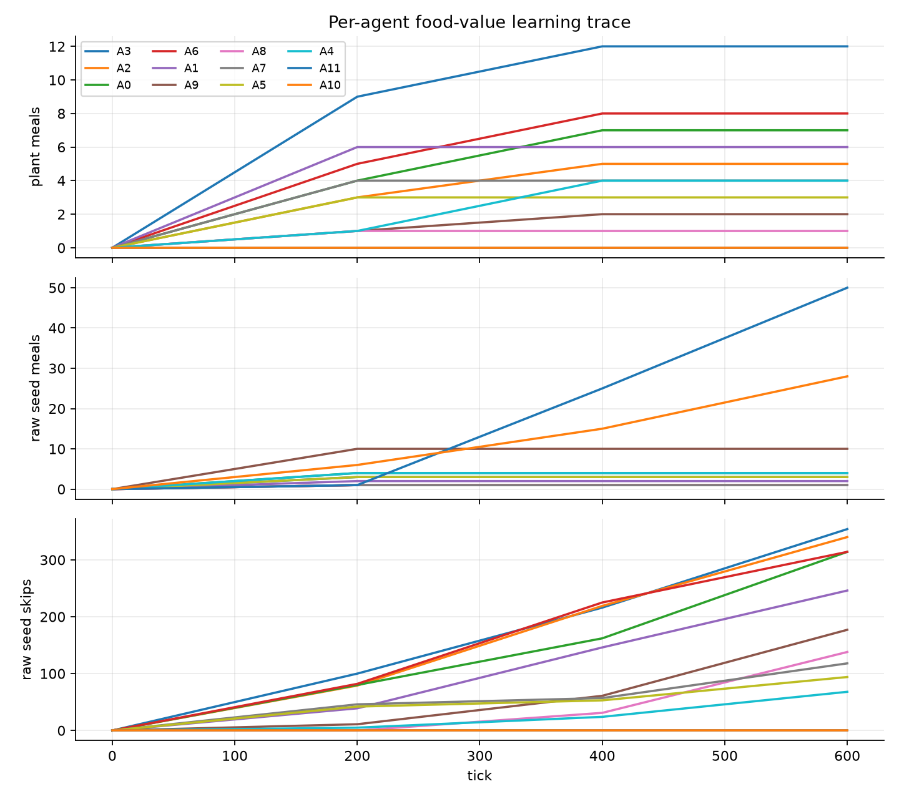
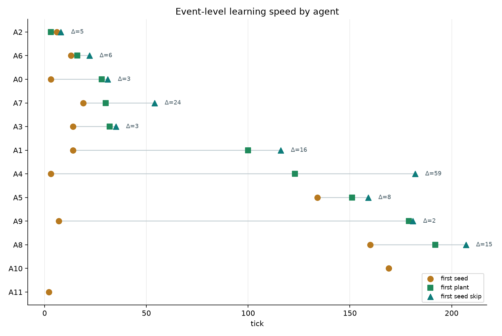

# รายงานฉบับเต็ม: agent ที่เลิกกินเมล็ดเรียนรู้เองหรือบอกต่อกัน?

**โครงการ:** Artificial Evolution (food-value learning / per-agent behavior trace)
**วันที่:** 2026-06-23
**ผู้ทดลอง:** Chisanupong
**สถานะ:** เพิ่ม telemetry ราย agent แล้ว · smoke run verify แล้ว · unit tests 25/25 · ยังเป็นหลักฐานเบื้องต้น ไม่ใช่ confirmatory multi-seed
**ไฟล์ผลลัพธ์หลัก:** `.codex-temp/food_tag_smoke.json`, `reports/figures/agent_food_value_individual_tracking_2026-06-23.png`, `reports/figures/agent_food_value_learning_events_2026-06-23.png`

---

## บทคัดย่อ (Abstract)

รายงานก่อนหน้าแสดงว่าเมื่อเปิดกลไก food-value learning แล้ว agent สามารถเรียนรู้ได้ว่า `raw_seed` เป็นอาหารที่ **กินได้แต่ให้พลังงานต่ำกว่า `raw_plant`** และเมื่อเวลาผ่านไป อัตราการกิน seed ลดลงมาก แต่กราฟรวมระดับประชากรยังตอบคำถามสำคัญไม่ได้ว่า **agent เรียนรู้จากประสบการณ์ของตัวเอง หรือมีการบอกต่อ/เลียนแบบกันระหว่าง agent**

เพื่อแยกคำถามนี้ เราเพิ่ม telemetry รายตัวโดยไม่เปลี่ยนกฎการตัดสินใจหลัก: บันทึก `meals_by_type`, `skipped_food_by_type`, `food_value_memory`, และ trajectory ราย agent ตามเวลา จากนั้นรัน smoke test สั้นใน regime ที่มีพลังงานพอ เพื่อดูว่าการข้าม `raw_seed` เกิดกับ agent แบบใด

ผลหลัก: จาก agent 12 ตัว มี 10 ตัวที่เริ่มข้าม `raw_seed` และทั้ง 10 ตัวมี record ว่าเคยกินทั้ง `raw_seed` และ `raw_plant` มาก่อน ขณะที่ 2 ตัวที่เคยกินแต่ `raw_seed` แต่ยังไม่เคยกิน `raw_plant` ยังไม่ข้าม seed เลย ตัวชี้วัดสำคัญ `agents_skipped_seed_without_recorded_taste = 0` นอกจากนี้ยังคำนวณ learning speed รายตัวได้จาก `first_raw_seed_skip_tick - first_raw_plant_tick` โดยรันนี้มีค่าเฉลี่ย `14.1 ticks` (ต่ำสุด `2`, สูงสุด `59`)

ข้อสรุปเบื้องต้น: หลักฐานรอบนี้สนับสนุน **individual learning** มากกว่า **social transmission** กล่าวคือ agent ที่เลิกกิน seed ดูเหมือนเรียนจากประสบการณ์ตรงของตัวเอง ยังไม่พบหลักฐานว่า agent ที่ไม่เคยชิม seed/plant เลือกไม่กินตามตัวอื่น หรือมีการบอกต่อค่าอาหารระหว่าง agent

---

## 1. บทนำ (Introduction)

### 1.1 ปัญหา

กราฟรวมจาก food-value learning study บอกว่าเมื่อ agent รู้ว่า `raw_seed` ให้พลังงานน้อยกว่า `raw_plant` แล้ว จำนวนการกิน seed ลดลงอย่างชัดเจน แต่กราฟรวมมีข้อจำกัดสำคัญ: มันรวมทุก agent เข้าด้วยกัน จึงไม่รู้ว่า pattern ที่เห็นเกิดจาก agent ตัวเดิมเรียนรู้เอง หรือเกิดจากบาง agent มีอิทธิพลต่อ agent อื่น

คำถามนี้สำคัญต่อ artificial life เพราะ **การเรียนรู้รายตัว** กับ **การถ่ายทอดพฤติกรรมทางสังคม** เป็นคนละระดับของ emergence:

- individual learning = agent ปรับพฤติกรรมจาก reward/energy feedback ของตัวเอง
- social transmission = agent ที่ไม่มีประสบการณ์ตรงเปลี่ยนพฤติกรรมเพราะได้รับอิทธิพลจาก agent อื่น
- inheritance / cultural carryover = ลูกหรือ agent รุ่นต่อไปมี bias จากพ่อแม่หรือกลุ่ม แม้ยังไม่เคยลองเอง

ถ้าเราอ้างจากกราฟรวมเร็วเกินไป อาจ overclaim ว่าเกิด social learning ทั้งที่จริงอาจเป็นเพียง agent หลายตัวเรียนรู้แยกกัน

### 1.2 ช่องว่างงานวิจัย (research gap)

รายงาน food-value learning เดิมพิสูจน์ว่า **กลไกเรียนรู้ค่าอาหารทำงาน** แต่ยังไม่ได้พิสูจน์ว่า:

1. agent แต่ละตัวมี learning trajectory แบบเดียวกันหรือไม่
2. agent ที่ข้าม seed เคยชิม seed เองมาก่อนหรือไม่
3. agent ที่ไม่เคยชิมอาหารชนิดหนึ่งสามารถไม่กินตามตัวอื่นได้หรือไม่
4. ลูกหรือ agent รุ่นถัดไปได้รับ food-value memory จากพ่อแม่หรือไม่

ดังนั้นรอบนี้ไม่ใช่การพิสูจน์ food-value learning ซ้ำ แต่เป็นการเพิ่ม **per-agent causal trace** เพื่อแยก individual learning ออกจาก social transmission

### 1.3 สมมติฐาน (hypotheses)

- **H1 (individual learning):** agent จะข้าม `raw_seed` ก็ต่อเมื่อ agent ตัวนั้นเคยชิม `raw_seed` และมีค่าอาหารชนิดอื่นที่ดีกว่า เช่น `raw_plant`
- **H2 (social transmission):** agent บางตัวจะข้าม `raw_seed` ทั้งที่ไม่มี record ว่าเคยชิม `raw_seed` หรือยังไม่มี food-value memory ของตัวเอง
- **H3 (aggregate artifact):** กราฟรวมที่ดูเหมือนประชากร “เรียนรู้พร้อมกัน” จริง ๆ แล้วเกิดจาก trajectory รายตัวที่ต่างกันและถูกเฉลี่ยรวม

---

## 2. การวิเคราะห์สถาปัตยกรรม (จากโค้ดจริง)

### 2.1 กลไกเดิมก่อนเพิ่ม telemetry

จากโค้ดปัจจุบัน food-value learning เป็น memory ภายใน agent แต่ละตัว:

| ชั้น | กลไก | มีผลต่อคำถาม social learning อย่างไร |
| --- | --- | --- |
| ตัวตน | `agent_id`, `lineage_id`, `generation`, `parent_id` | มี tag รายตัวอยู่แล้ว จึงใช้แยก trajectory ได้ |
| ประสบการณ์กิน | `meals_by_type` | บอกว่า agent ตัวใดเคยกิน food kind ใด |
| ความจำค่าอาหาร | `food_value_memory` | เป็น dict ใน agent แต่ละตัว ไม่ใช่ global memory |
| การตัดสินใจข้ามอาหาร | `_food_worth_eating` | ใช้ค่าใน `food_value_memory` ของตัวเองเท่านั้น |
| การเกิดลูก | `spawn_child` | สร้างลูกใหม่ แต่ไม่ได้ส่งต่อ `food_value_memory` |
| social group | `friend_ids`, `local_group_members`, roles | มี social structure แต่ยังไม่มี channel ส่งต่อค่าอาหาร |

นัยสำคัญ: ก่อนเพิ่ม telemetry ยังไม่เห็นกลไก “บอกต่อค่าอาหาร” ในโค้ดโดยตรง ถ้าพบ agent ที่ไม่เคยชิมแต่ข้าม seed ได้ จะเป็นสัญญาณแปลกที่ต้อง trace ต่อ แต่ baseline expectation จาก architecture คือ **memory รายตัว**

### 2.2 สิ่งที่เพิ่มในรอบนี้

เพิ่ม instrumentation โดยตั้งใจให้เป็นการวัด ไม่ใช่การสอน agent เพิ่ม:

| สิ่งที่เพิ่ม | ไฟล์ | หน้าที่ |
| --- | --- | --- |
| `skipped_food_by_type` | `agents/agent.py` | นับว่า agent ตัวนั้นข้ามอาหารชนิดใดกี่ครั้ง |
| event `food_skipped` | `agents/agent.py` | บันทึกเหตุการณ์ข้ามอาหาร พร้อม learned value และ best known value |
| `_agent_diet_rows` | `scripts/run_long_emergence_watch.py` | สร้างตารางราย agent ตอนจบและระหว่างรัน |
| `agent_diet_metrics` | `scripts/run_long_emergence_watch.py` | สรุปจำนวน agent ตามสถานะการเรียนรู้ |
| `agent_diet_trajectory` | `scripts/run_long_emergence_watch.py` | เก็บ time series ราย agent ทุก interval |
| plot utility | `scripts/plot_agent_diet_trajectory.py` | สร้างกราฟ plant meals / seed meals / seed skips แยก agent |

สถานะสำคัญ: การเพิ่มนี้ไม่ทำให้ agent มี social learning เพิ่มขึ้นเอง เพียงแต่เปิดไฟให้เห็นว่า agent ตัวไหนกินหรือข้ามอะไร

---

## 3. ระเบียบวิธี (Methods)

### 3.1 การออกแบบการวัด

รอบนี้เป็น **instrumentation smoke run** ไม่ใช่ confirmatory experiment ขนาดใหญ่ เป้าหมายคือยืนยันว่าเราสามารถแยกผลรายตัวได้ และดู pattern เบื้องต้นว่าเข้ากับ H1 หรือ H2

| องค์ประกอบ | รายละเอียด |
| --- | --- |
| IV หลัก | เวลา, encounter กับ `raw_seed`/`raw_plant`, เปิด food-value learning |
| DV หลัก | `raw_seed_meals`, `plant_meals`, `raw_seed_skips` แยกตาม `agent_id` |
| ตัวชี้วัด H1 | agent ที่ข้าม seed ต้องเคยชิม seed และ plant เอง |
| ตัวชี้วัด H2 | agent ที่ข้าม seed โดยไม่มี record ว่าเคยชิม seed เอง |
| ตัวชี้วัด aggregate artifact | trajectory รายตัวแตกต่างกัน แต่กราฟรวมอาจทำให้ดูเหมือนพร้อมกัน |
| ตัวชี้วัด learning speed | `delta_learning_ticks = first_raw_seed_skip_tick - first_raw_plant_tick` |

### 3.2 คอนฟิกรัน

ใช้รันสั้นเพื่อ validate telemetry:

| parameter | value |
| --- | --- |
| seed | `20260610` |
| metabolism model | `v2` |
| body index | `37` |
| body | `sensor=2, muscle=2, armor=0, brain=2, social_planner` |
| ticks | `600` |
| day | `30` |
| initial population | `12` |
| final population | `12` |
| births | `0` |
| world | `40x40` |
| low-value food | `raw_seed` |
| low-value spawn | `6` per tick |
| value learning | enabled |
| food energy multiplier | `50` |
| drain multiplier | `0.1` |

ใช้ energy-surplus regime เพื่อให้พฤติกรรมเลือกกินไม่ถูก perma-starvation กลบเหมือนในรายงานก่อนหน้า:

| energy metric | value |
| --- | ---: |
| mean energy | 1384.03 |
| min energy | 160.5 |
| max energy | 2988.4 |
| deficit per agent tick | 0.0 |
| intake per agent tick | 2.5556 |
| drain total per tick | 0.4793 |

### 3.3 คำสั่งที่ใช้

```powershell
python scripts\food_value_study_driver.py --model v2 --ticks 600 --output .codex-temp\food_tag_smoke_run --low-value-food 6 --value-learning --food-energy-mult 50 --drain-mult 0.1 --population 12 --world 40 --max-pop 40 --dump .codex-temp\food_tag_smoke.json
python scripts\plot_agent_diet_trajectory.py .codex-temp\food_tag_smoke.json --output reports\figures\agent_food_value_individual_tracking_2026-06-23.png --max-agents 12
```

### 3.4 นิยามสถานะราย agent

| state | ความหมาย |
| --- | --- |
| `self_tasted_both_then_skipped_seed` | agent เคยกินทั้ง seed และ plant แล้วเริ่มข้าม seed |
| `seed_only_no_plant_taste` | agent เคยกิน seed แต่ยังไม่เคยกิน plant จึงยังไม่มีฐานเปรียบเทียบ |
| `skipped_seed_without_recorded_taste` | agent ข้าม seed ทั้งที่ไม่มี record ว่าเคยชิม seed |

สถานะสุดท้ายเป็นตัวชี้วัดที่สำคัญที่สุดสำหรับ social transmission ในรันนี้ ถ้าค่านี้มากกว่า 0 จะเป็นสัญญาณว่ามี agent ทำพฤติกรรม “ไม่กินตาม” โดยไม่มีประสบการณ์ตรง

---

## 4. ผลการทดลอง (Results)

### 4.1 ภาพรวมประชากร

| ตัวชี้วัด | ค่า |
| --- | ---: |
| agents observed | 12 |
| agents tasted `raw_seed` | 12 |
| agents tasted `raw_plant` | 10 |
| agents skipped `raw_seed` | 10 |
| agents skipped seed without recorded taste | **0** |
| total `raw_seed` meals | 108 |
| total plant meals | 52 |
| total `raw_seed` skips | 2163 |
| agents with learning speed | 10 |
| mean Δlearning | 14.1 ticks |
| min / max Δlearning | 2 / 59 ticks |

ผลนี้ชี้ว่า agent จำนวนมากข้าม seed จริง แต่การข้าม seed ทั้งหมดเกิดในกลุ่มที่มีประสบการณ์ตรง ไม่พบ agent ที่ข้าม seed โดยไม่มี record การชิม seed

### 4.2 learned food value

| food kind | learned value |
| --- | ---: |
| `raw_seed` | 50.0 |
| `raw_plant` | 250.0 |

เพราะรันนี้ใช้ `food_energy_multiplier=50`, ค่า raw จากรายงานก่อนหน้า `seed=1`, `plant=5` จึงกลายเป็น `seed=50`, `plant=250` อัตราส่วนยังเหมือนเดิมคือ `0.2` ซึ่งต่ำกว่า `diet_pickiness=0.5` อย่างชัดเจน

ตัวอย่าง event ที่ยืนยันเหตุผลการข้าม:

```text
food_skipped -> agent=2 source=low_value_study x=33 y=19 kind=raw_seed energy=1 learned_value=50.000 best_known=250.000 pickiness=0.500 reason=low_value
```

อ่านแบบ causal trace: agent 2 ข้าม `raw_seed` เพราะค่าที่เรียนของ seed คือ 50 ขณะที่ best known คือ 250 และ threshold คือ 0.5 x 250 = 125 ดังนั้น seed ต่ำกว่า threshold จึงถูกข้าม

### 4.3 ผลราย agent

| agent | lineage | sex | seed meals | plant meals | seed skips | first seed | first plant | first skip | Δlearning | state |
| ---: | --- | --- | ---: | ---: | ---: | ---: | ---: | ---: | ---: | --- |
| 3 | D01 | male | 3 | 12 | 354 | 14 | 32 | 35 | 3 | self tasted both then skipped seed |
| 2 | C01 | male | 1 | 5 | 340 | 6 | 3 | 8 | 5 | self tasted both then skipped seed |
| 0 | A01 | male | 4 | 7 | 314 | 3 | 28 | 31 | 3 | self tasted both then skipped seed |
| 6 | G01 | female | 1 | 8 | 314 | 13 | 16 | 22 | 6 | self tasted both then skipped seed |
| 1 | B01 | male | 2 | 6 | 246 | 14 | 100 | 116 | 16 | self tasted both then skipped seed |
| 9 | J01 | female | 10 | 2 | 177 | 7 | 179 | 181 | 2 | self tasted both then skipped seed |
| 8 | I01 | female | 1 | 1 | 138 | 160 | 192 | 207 | 15 | self tasted both then skipped seed |
| 7 | H01 | female | 1 | 4 | 118 | 19 | 30 | 54 | 24 | self tasted both then skipped seed |
| 5 | F01 | male | 3 | 3 | 94 | 134 | 151 | 159 | 8 | self tasted both then skipped seed |
| 4 | E01 | male | 4 | 4 | 68 | 3 | 123 | 182 | 59 | self tasted both then skipped seed |
| 10 | K01 | female | 28 | 0 | 0 | 169 | - | - | - | seed only, no plant taste |
| 11 | L01 | female | 50 | 0 | 0 | 2 | - | - | - | seed only, no plant taste |

ข้อสังเกตหลัก:

1. agent 10 และ 11 กิน seed จำนวนมาก แต่ไม่เคยกิน plant จึงยังไม่ข้าม seed
2. agent ที่ข้าม seed ทุกตัวมีค่า learned plant แล้ว
3. ไม่มี agent ใดอยู่ใน state `skipped_seed_without_recorded_taste`

นี่เป็นผลที่แยกจากกราฟรวมไม่ได้ ถ้าดูแต่ population-level อาจเห็นว่า seed skips สูงมาก แต่เมื่อแยก agent พบว่า skip เกิดเฉพาะใน agent ที่มีฐานเปรียบเทียบจากประสบการณ์ตรง

### 4.4 กราฟ trajectory ราย agent



กราฟแยกเป็น 3 แผง: plant meals, raw seed meals, raw seed skips ตาม tick ราย agent สิ่งที่เห็นชัดคือ:

- agent บางตัวได้ plant เร็ว แล้ว raw seed skips เพิ่มเร็ว
- agent บางตัวยังกิน seed ต่อ เพราะยังไม่มี plant taste
- การเปลี่ยนพฤติกรรมไม่ได้เกิดพร้อมกันทั้งประชากร แต่เกิดต่างจังหวะตามประสบการณ์ของแต่ละตัว

ดังนั้นกราฟรวมเดิมไม่ได้ผิด แต่ซ่อน heterogeneity ราย agent เอาไว้

### 4.5 Event-level learning speed

นิยาม:

```text
Δlearning = first_raw_seed_skip_tick - first_raw_plant_tick
```

ความหมาย: หลังจาก agent ได้หลักฐานจาก `raw_plant` ครั้งแรกแล้ว ใช้เวลากี่ tick จึงเริ่มข้าม `raw_seed` ครั้งแรก



ผลรันนี้:

- agent ที่คำนวณ Δlearning ได้: 10 ตัว
- ค่าเฉลี่ย: 14.1 ticks
- เร็วสุด: 2 ticks (A9)
- ช้าที่สุด: 59 ticks (A4)
- agent 10 และ 11 ไม่มีค่า Δlearning เพราะยังไม่เคยกิน plant และยังไม่ skip seed

นี่เป็น metric ที่มีประโยชน์มากกว่าการดู seed skips สะสมอย่างเดียว เพราะวัด acquisition latency โดยตรง: agent เรียนรู้เร็วแค่ไหนหลังได้ข้อมูลเปรียบเทียบครั้งแรก

### 4.6 Food availability

| food kind | spawned / standing |
| --- | ---: |
| `raw_seed` spawned | 2445 |
| `raw_plant` spawned | 218 |
| standing `raw_seed` at final | 537 |

มี seed เหลือค้างจำนวนมากในโลก สอดคล้องกับผลว่า agent หลายตัวเริ่มข้าม seed หลังเรียนรู้ค่าแล้ว ไม่ใช่ seed หายไปจาก availability

---

## 5. อภิปราย (Discussion)

### 5.1 ตอบคำถามวิจัย

**คำตอบรอบนี้:** ยังไม่พบหลักฐานการบอกต่อหรือเลียนแบบโดยไม่มีประสบการณ์ตรง หลักฐานที่มีสอดคล้องกับ individual learning

เหตุผล:

1. agent ที่ข้าม seed ทุกตัวเคยกิน seed เอง
2. agent ที่ข้าม seed ทุกตัวเคยกิน plant เอง
3. agent ที่ยังไม่เคยกิน plant ยังไม่ข้าม seed แม้อยู่ในประชากรเดียวกับ agent ที่ข้าม seed แล้ว
4. architecture ปัจจุบันไม่มี channel ส่งต่อ `food_value_memory` ระหว่าง agent

ดังนั้นข้อสรุปที่ควรใช้คือ:

> agent สามารถเรียนรู้ค่าอาหารรายตัวได้ แต่ telemetry รอบนี้ยังไม่สนับสนุนว่าเกิดการถ่ายทอดความรู้อาหารระหว่าง agent

### 5.2 ทำไมกราฟรวมจึงยังไม่พอ

กราฟรวมตอบได้ว่า population กิน seed ลดลงหรือไม่ แต่ตอบไม่ได้ว่า:

- agent ตัวเดิมลดเองหรือ agent คนละกลุ่มถูกนับรวม
- agent ที่ไม่กิน seed เคยชิม seed มาก่อนหรือไม่
- agent ที่ไม่กิน seed เคยชิม plant มาก่อนหรือไม่
- agent ที่ยังไม่เคยชิมมีพฤติกรรมตามตัวอื่นหรือไม่

per-agent tagging จึงเป็นขั้นจำเป็นก่อนจะอ้าง social learning

### 5.3 สัญญาณที่ต้องเห็น ถ้าจะอ้าง social transmission

ถ้าจะกล่าวว่า agent มีการบอกต่อ/เลียนแบบ เราควรเห็นอย่างน้อยหนึ่งอย่าง:

1. `skipped_seed_without_recorded_taste > 0`
2. agent ที่ไม่มี `raw_plant` memory เริ่มข้าม seed หลังอยู่ใกล้ agent ที่มี plant memory
3. ลูกที่เกิดใหม่เริ่มเลี่ยง seed เร็วกว่ากลุ่ม control ทั้งที่ยังไม่มีประสบการณ์ตรง
4. social isolation ทำให้ learning curve ช้ากว่า social exposure
5. ปิด `friend_ids`/group interaction แล้วการแพร่พฤติกรรมหายไป

รันนี้ยังไม่ทดสอบเงื่อนไขเหล่านี้เต็มรูปแบบ จึงควรใช้ถ้อยคำว่า “ยังไม่พบหลักฐาน social transmission” ไม่ใช่ “พิสูจน์ว่าไม่มี social transmission”

---

## 6. ข้อจำกัด (Limitations)

1. **เป็น smoke run** — เป้าหมายคือ validate telemetry ไม่ใช่สรุปเชิงสถิติสุดท้าย
2. **n=1 seed** — ยังไม่ได้รันหลาย seed หรือ confidence interval
3. **ticks สั้น** — 600 ticks พอเห็น per-agent pattern แต่ไม่พอทดสอบ long-run ecology
4. **ไม่มี births** — ยังไม่ทดสอบ parent-child transmission หรือ inheritance/cultural carryover
5. **ยังไม่มี social exposure design** — ยังไม่ได้บังคับให้ naive agent อยู่ใกล้ knowledgeable agent
6. **ยังวัด encounter ไม่ครบ** — รู้ว่า agent กิน/ข้ามอะไร แต่ยังไม่ได้บันทึกทุกครั้งที่ agent เห็นอาหารหรือเห็น agent อื่นกิน
7. **energy-surplus regime เป็นเงื่อนไขทดลอง** — ตั้งใจใช้เพื่อไม่ให้ starvation กลบ decision แต่ยังไม่ใช่โลกธรรมชาติเต็มรูป

---

## 7. งานต่อไป (Future Work)

1. **Social exposure experiment** — แยกกลุ่ม knowledgeable / naive แล้วบังคับ proximity เพื่อดูว่า naive เปลี่ยนพฤติกรรมไหม
2. **Isolation control** — ให้ agent อยู่คนละพื้นที่ แล้วเทียบ learning curve กับกลุ่ม social
3. **Parent-child test** — ทำให้เกิด births แล้วตรวจว่า child มี `food_value_memory` ว่างจริงหรือมี bias ตามพ่อแม่
4. **Encounter-level telemetry** — บันทึก `food_seen`, `food_eaten`, `food_skipped`, และ nearby agents ณ เวลาตัดสินใจ
5. **Memory disabled control** — ปิด food-value memory เพื่อยืนยันว่า seed skips หายไป
6. **Neighbor influence metric** — วัดจำนวน tick ที่ naive agent อยู่ใกล้ knowledgeable agent ก่อนการตัดสินใจครั้งแรก
7. **Multi-seed confirmatory run** — ใช้ 5-10 seeds และสรุป state counts พร้อม uncertainty

---

## 8. กรอบหลักฐาน (hypothesis-testing)

| หลักฐาน | รายละเอียด |
| --- | --- |
| **Supporting H1** | 10/10 agent ที่ข้าม seed เคยกินทั้ง seed และ plant เอง; learned value ของตัวเองมี seed=50, plant=250; agent ที่ไม่มี plant taste ไม่ข้าม seed |
| **Against H2 รอบนี้** | `agents_skipped_seed_without_recorded_taste = 0`; ไม่มี evidence ว่า naive agent ไม่กินตาม |
| **Supporting H3** | trajectory รายตัวต่างกันมาก; Δlearning กระจายตั้งแต่ 2 ถึง 59 ticks; กราฟรวมจึงซ่อนว่า agent บางตัวยังไม่เรียน plant และยังกิน seed ต่อ |
| **Missing** | proximity/social exposure, parent-child run, multi-seed replication, encounter-level “เห็นแต่ไม่กิน” trace |
| **Confidence** | individual learning ใน smoke run = **กลางถึงสูง**; social transmission = **ยังไม่พบหลักฐาน**; generalization = **ต่ำถึงกลาง** เพราะยังเป็น smoke run |

---

## 9. การทำซ้ำ (Reproducibility)

**โค้ดที่เกี่ยวข้อง:**

- `agents/agent.py` — `skipped_food_by_type`, `_record_skipped_food`, event `food_skipped`
- `scripts/run_long_emergence_watch.py` — `_agent_diet_rows`, `_agent_diet_metrics`, `agent_diet_summary`, `agent_diet_trajectory`
- `scripts/food_value_study_driver.py` — summary ราย agent ใน output
- `scripts/plot_agent_diet_trajectory.py` — render กราฟราย agent

**คำสั่งรัน smoke:**

```powershell
python scripts\food_value_study_driver.py --model v2 --ticks 600 --output .codex-temp\food_tag_smoke_run --low-value-food 6 --value-learning --food-energy-mult 50 --drain-mult 0.1 --population 12 --world 40 --max-pop 40 --dump .codex-temp\food_tag_smoke.json
python scripts\plot_agent_diet_trajectory.py .codex-temp\food_tag_smoke.json --output reports\figures\agent_food_value_individual_tracking_2026-06-23.png --event-output reports\figures\agent_food_value_learning_events_2026-06-23.png --max-agents 12
```

**Validation ที่ทำแล้ว:**

```powershell
python -m py_compile agents\agent.py scripts\run_long_emergence_watch.py scripts\food_value_study_driver.py scripts\plot_agent_diet_trajectory.py
python -m unittest tests.test_metabolism
```

ผล: unit tests 25/25 ผ่าน

---

## ภาคผนวก: ตัวเลขหลักจาก run

```json
{
  "agents_observed": 12,
  "agents_tasted_raw_seed": 12,
  "agents_tasted_raw_plant": 10,
  "agents_skipped_raw_seed": 10,
  "agents_skipped_seed_without_recorded_taste": 0,
  "total_raw_seed_meals": 108,
  "total_plant_meals": 52,
  "total_raw_seed_skips": 2163,
  "agents_with_learning_speed": 10,
  "mean_delta_learning_ticks": 14.1,
  "min_delta_learning_ticks": 2,
  "max_delta_learning_ticks": 59,
  "food_value_learning_state_counts": {
    "seed_only_no_plant_taste": 2,
    "self_tasted_both_then_skipped_seed": 10
  }
}
```

---

## สรุปสั้นที่สุด

จากข้อมูลรายตัวรอบนี้ agent ไม่ได้ “บอกต่อ” ให้เห็นในหลักฐานที่มี แต่แต่ละตัวเรียนจากประสบการณ์ตรงของตัวเอง: ตัวที่รู้ทั้ง seed และ plant เริ่มข้าม seed ส่วนตัวที่ยังรู้แต่ seed ยังไม่ข้าม seed
