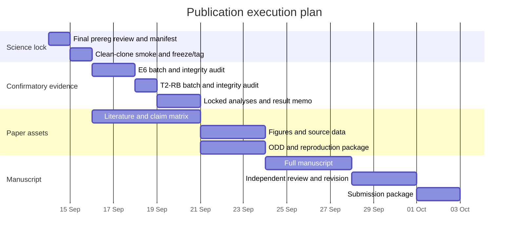

# แผนดำเนินงานจาก preregistration ถึงส่งตีพิมพ์

โครงการ: Artificial Evolution — temporal toxicity and resource-age information

วันที่จัดทำ: 2026-09-13

เป้าหมายวารสารเบื้องต้น: *Artificial Life*

สถานะเริ่มต้น: เลือกเรื่องแล้ว, pilot เชิงวิศวกรรมเสร็จ, E1–E5 มีผล, E6/T2-RB ยังเป็น DRAFT และยังไม่รันชุดยืนยัน

## 1. เป้าหมายที่ถือว่าเสร็จจริง

งานจะถือว่าพร้อมส่งเมื่อครบทั้งห้า lock:

1. **Science lock:** preregistration ถูกตรวจ, commit และ tag ก่อนเห็นข้อมูลยืนยัน
2. **Evidence lock:** E6 450 รันและ T2-RB 150 รันครบ พร้อม provenance และ analysis ที่ผ่าน guard
3. **Reproducibility lock:** clean-clone reproduction ผ่าน, code/data/spec/figures สร้างซ้ำได้ และ archive มี DOI
4. **Manuscript lock:** ข้ออ้างทุกข้อผูกกับหลักฐานหรือ citation ที่ตรวจฉบับเต็มแล้ว
5. **Submission lock:** ไฟล์ บัญชีผู้เขียน disclosure และ cover letter ผ่าน checklist ของวารสาร

การได้ p-value ต่ำไม่ใช่ definition of done ผลลบหรือผลก้ำกึ่งถือว่าเสร็จได้หากทำตามแผนและรายงาน uncertainty ครบ

## 2. บทบาท

| บทบาท | ความรับผิดชอบ |
|---|---|
| ผู้เขียนหลัก | ตัดสินใจเชิงวิทยาศาสตร์, รับรองสมมติฐาน/SESOI, ตรวจข้อความและ citation, เลือก license, อนุมัติไฟล์ที่จะส่ง และรับผิดชอบผลงานทั้งหมด |
| Codex | ตรวจโค้ดและข้อมูล, เตรียมสเปก/สคริปต์/ตาราง/รูป/ร่างต้นฉบับ, รันขั้นตอนที่ได้รับมอบหมาย และรายงานข้อจำกัดตามหลักฐาน |
| ผู้ตรวจอิสระ | ใช้ clean clone ทำ reproduction, ตรวจ ODD/คำสั่ง และบันทึกสิ่งที่ทำไม่ได้โดยไม่รับคำอธิบายจากผู้พัฒนาในรอบแรก |
| อาจารย์หรือที่ปรึกษา | อ่าน claim/novelty และต้นฉบับแบบ reviewer; ไม่เปลี่ยนผลหรือสมมติฐานหลังเห็นข้อมูล |

หากยังไม่มีผู้ตรวจอิสระ ให้เตรียม reproduction package ให้พร้อมก่อน แล้วกำหนดผู้ตรวจภายหลัง ห้ามนับการรันซ้ำโดยผู้พัฒนาใน working directory เดิมเป็น independent reproduction

## 3. กำหนดการ 21 วัน

สมมติว่าทำงานเฉลี่ยวันละ 3–5 ชั่วโมงและเครื่องรันงานต่อเนื่องได้ หากเวลาไม่ตรง ให้ยึด gate และ dependency มากกว่าวันที่



## 4. Phase 0 — ตรวจ preregistration รอบสุดท้าย

เวลา: ครึ่งวันถึงหนึ่งวัน

### งาน

- อ่าน [`DRAFT_PREREG_E6_representation_payoff.th.md`](DRAFT_PREREG_E6_representation_payoff.th.md) ทีละข้อโดยไม่เปิดผล pilot ระหว่างตัดสินใจ
- ยืนยันคำถามหลัก E6 ว่าเป็นผลของ resource-age-informed representation ต่อ empirical RMST/lifespan ตลอดแกน realized fruit energy; resource age คืออายุของชิ้นอาหารตั้งแต่ถูกสร้าง ไม่ใช่อายุ agent
- ยืนยัน SESOI:
  - E6 slope = 1 tick ต่อหนึ่งหน่วยพลังงาน
  - T2-RB paired difference = 5 tick
- ยืนยัน E6: 30 seed, 15 arms, 450 runs
- ยืนยัน T2-RB: 50 seed, 3 arms, 150 runs
- ตรวจว่า seed สองชุดไม่ทับกันและไม่ทับ pilot
- ระบุ primary, secondary, mechanism checks, multiplicity, censoring, failure และ deviation handling แบบไม่มีช่องตีความ
- ใช้ `founder_mean_followup_ticks = final age - deterministic initial age` เป็น empirical restricted mean follow-up: horizon 800 สำหรับ E6 และ 400 สำหรับ T2-RB; เก็บ `founder_mean_age` ไว้เพื่อเทียบงานเดิมแต่ไม่ใช้เป็นชื่อ outcome หลัก
- ตรวจว่าการทดสอบ n > 20 ระบุ seeded Monte Carlo sign-flip 200,000 draws ไม่เรียกว่า exact
- สร้าง `PREREGISTRATION_MANIFEST.json` ซึ่งบันทึกชื่อไฟล์, SHA-256, commit, Python version, analysis scripts และจำนวน run ที่คาดหวัง

### จุดตัดสินใจที่ผู้เขียนต้องรับรอง

- age cue เป็นข้อมูลที่ผู้ทดลองให้ ไม่ใช่ cue ที่ agent ค้นพบ
- H6.1 เป็นข้ออ้างหลักของบทความ
- T2-RB เป็น replication family แยก ไม่ใช่เงื่อนไขที่ทำให้ H6.1 ผ่านหรือไม่ผ่าน
- ไม่เพิ่ม seed หลังเห็น p-value
- ไม่ตัด outlier seed
- หาก mechanism gate ไม่ผ่าน จะลดความแรงของคำอธิบาย แต่ไม่ลบระดับพลังงานนั้น

### เกณฑ์ผ่าน G0

- [ ] ไม่มีคำว่า DRAFT ในไฟล์ prereg ที่จะตรึง
- [ ] JSON และเอกสารบอก seed/arm/metric/test ตรงกันทุกจุด
- [ ] deviation log เดิมครบและ commit history ตรวจได้
- [ ] manifest และ hash ถูกสร้างก่อน run
- [ ] full test suite ผ่าน

ถ้าแก้โค้ดหรือวิธีวิเคราะห์หลัง G0 ต้องย้อนกลับมาเริ่ม Phase 0 ใหม่และออก tag ใหม่ ห้ามแก้ tag เดิมเงียบ ๆ

## 5. Phase 1 — clean-clone smoke และ freeze

เวลา: ครึ่งวัน

### งาน

1. สร้าง clean checkout จาก commit ที่จะตรึง โดยไม่ใช้ working directory ที่มีข้อมูลเก่า
2. สร้าง smoke spec แยก ใช้ seed ที่ไม่อยู่ในชุด confirmatory
3. รันหนึ่ง smoke ต่อ 18 arms: E6 15 arms และ T2-RB 3 arms
4. ตรวจ metadata ต่อไฟล์:
   - multiplier ที่ร้องขอและค่าที่มีผลจริง
   - realized fruit energy เป็น 4, 5, 6, 8, 10 ตาม arm
   - `type_age` ส่ง `raw_fruit@0...@8`
   - `type_sham` มีจำนวน key ที่ตั้งใจและไม่สัมพันธ์กับอายุจริง
   - toxin profile W เป็น toxic → safe → toxic
   - encounter และ agent-outcome telemetry ไม่ว่าง
5. รัน analyzer กับข้อมูลสังเคราะห์และข้อมูล smoke เพื่อยืนยันว่า batch ที่ไม่ครบถูกปฏิเสธ
6. เมื่อผ่านทั้งหมดจึง commit final prereg/spec/manifest และสร้าง annotated tag

### คำสั่งตรวจหลัก

```powershell
python -m unittest discover -s tests
python -m py_compile scripts\run_e_series.py scripts\analyze_e6_representation_payoff.py scripts\analyze_t2rb_replication.py
git status --short --untracked-files=no
git diff --check
```

ห้ามใช้ `--allow-dirty` หรือ `--allow-draft` กับชุดยืนยัน

### เกณฑ์ผ่าน G1

- [ ] 18/18 smoke arms สำเร็จ
- [ ] metadata และ diagnostic ตรงสเปก
- [ ] tracked tree สะอาด
- [ ] prereg commit และ annotated tag มีอยู่และจดลง manifest

## 6. Phase 2 — รัน E6 ชุดยืนยัน

เวลาเครื่องโดยประมาณ: 2–4 ชั่วโมง; เผื่อหนึ่งวันสำหรับตรวจข้อมูล

### วิธีรัน

รันจาก tag ที่ G1 เท่านั้น เก็บ console output เป็น log และหลีกเลี่ยงการอ่านผลระหว่าง batch เพื่อไม่ให้เกิดการตัดสินใจใหม่กลางงาน

```powershell
python scripts\run_e_series.py --spec reports\prereg\E6_representation_payoff_spec.json --work-dir data\e6_representation_payoff_confirmatory_202609 --out-dir reports\e6_representation_payoff_confirmatory_202609 --jobs 4
```

### Integrity audit ก่อนวิเคราะห์

- จำนวนแถวต้องเท่ากับ 450
- 30 seed × 15 arms ต้องมีอย่างละหนึ่งแถว
- ไม่มี seed นอก manifest
- failures = 0
- git revision start = end = prereg commit
- dirty start/end = false
- realized energy ใน raw dump ตรง arm ทุกไฟล์
- checksum raw dump ครบ 450 ไฟล์
- ไม่มี output field หลักเป็น null
- รายงานจำนวน founder censored ทุก arm

หาก runtime failure เกิดขึ้น ให้เก็บไฟล์และ log เดิม แก้เฉพาะสาเหตุที่จำเป็น บันทึก deviation แล้วรันซ้ำ arm-seed เดิม ห้ามเปลี่ยน seed หรือเติม run สำรอง

### วิเคราะห์หลัก

```powershell
python scripts\analyze_e6_representation_payoff.py --runs reports\e6_representation_payoff_confirmatory_202609\E6_runs.json --out reports\e6_representation_payoff_confirmatory_202609\E6_primary.json
```

analyzer ต้องคืน success เฉพาะเมื่อ provenance, seed identity และทุก arm ครบ

### เกณฑ์ผ่าน G2

- [ ] batch ผ่าน integrity audit
- [ ] `E6_primary.json` ถูกสร้างจาก analyzer ที่อยู่ใน prereg commit
- [ ] เก็บผลระดับพลังงานทุกจุด ไม่รายงานเฉพาะเส้น trend
- [ ] ยังไม่มีการเปลี่ยนสมมติฐาน ชื่อ arm หรือ exclusion rule

## 7. Phase 3 — รัน T2-RB replication

เวลาเครื่องโดยประมาณ: 1–2 ชั่วโมง; เผื่อครึ่งวันตรวจข้อมูล

รันหลัง E6 เพื่อให้ batch หลักปิดก่อน และรันจาก code revision เดียวกัน

```powershell
python scripts\run_e_series.py --spec reports\prereg\T2_RB_replication_spec.json --work-dir data\t2rb_replication_confirmatory_202609 --out-dir reports\t2rb_replication_confirmatory_202609 --jobs 4
python scripts\analyze_t2rb_replication.py --runs reports\t2rb_replication_confirmatory_202609\T2RB_runs.json --out reports\t2rb_replication_confirmatory_202609\T2RB_primary.json
```

### Integrity audit

- 50 seed × 3 arms = 150 rows
- A2, A3O และ A3R ครบทุก seed
- provenance ผ่านกฎเดียวกับ E6
- รายงาน realized dose ของ A2/A3O/A3R แม้จะไม่เท่ากันพอดี
- ห้าม recalibrate A3R หลังเห็นผลอายุขัย

### เกณฑ์ผ่าน G3

- [ ] batch และ analyzer ผ่าน guard
- [ ] A2-A3R เป็น primary ตาม prereg
- [ ] A2-A3O ถูกระบุเป็น direct-replication secondary
- [ ] ผลไม่ถูกใช้ย้อนกลับไปเปลี่ยน H6.1

## 8. Phase 4 — result lock และการตีความ

เวลา: หนึ่งถึงสองวัน

สร้างผลสองชั้น:

1. machine-readable JSON/CSV ที่มาจาก analyzer โดยตรง
2. `CONFIRMATORY_RESULTS_MEMO.th.md` ที่บอกผลตาม decision rule โดยไม่ใช้ภาษาประชาสัมพันธ์

### E6 decision table

| ผล | ข้อสรุปที่อนุญาต |
|---|---|
| mean slope > 0 และ CI ไม่คร่อม 0 | age information มี survival effect ที่เพิ่มตาม resource energy ภายใน ecology/learner ที่ทดสอบ |
| mean slope > 0 แต่ CI คร่อม 0 | ทิศทางสอดคล้องแต่ uncertainty ยังไม่รองรับ systematic effect |
| mean slope ใกล้ 0 และ CI แคบ | age information แก้ discrimination แต่ไม่มี survival gradient ที่มีความหมายในช่วงนี้ |
| slope < 0 | รายงานทิศตรงข้ามและอธิบายผ่าน mechanism data โดยไม่เปลี่ยน outcome |
| pattern โค้งแต่ slope ใกล้ 0 | primary linear trend ไม่ผ่าน; รายงานรูปแบบโค้งเป็น exploratory และแสดงทุกระดับ |

### T2-RB decision table

| ผล | ข้อสรุปที่อนุญาต |
|---|---|
| A2-A3R < 0 พร้อม CI ไม่คร่อม 0 | ผล exploratory ใน E5 ทำซ้ำได้ภายใต้ R-B และวิธี dose match ที่ตรึงไว้ |
| CI คร่อม 0 | replication ยังไม่ชี้ขาด; รายงาน precision และห้ามใช้ p เดิมรวมเป็นข้อยืนยัน |
| A3R กับ A3O ให้ข้อสรุปต่างกัน | ผลไวต่อ dose-matching method และต้องลดข้ออ้างให้แคบ |
| ทิศกลับ | รายงาน failure to replicate และย้าย T2 ไปเป็น boundary/limitation |

### Sensitivity ที่อนุญาต

- empirical RMST ที่ horizon เดิม
- complete-case deaths เป็นผลรองพร้อมคำเตือนเรื่อง selection จาก censoring
- leave-one-seed-out influence โดยไม่ตัด seed
- t CI และ bootstrap CI
- paired result per energy พร้อม Holm สำหรับ secondary family

ทุก analysis ที่ไม่ได้อยู่ใน prereg ต้องติดป้าย exploratory

## 9. Phase 5 — figures และ source data

เวลา: สองถึงสามวัน

| Figure | เนื้อหา | Source | เกณฑ์ผ่าน |
|---|---|---|---|
| 1 | toxin profile W, age bins และ key ของ B1/B2/B3 | สมการและ parameter table | toxic-safe-toxic เห็นได้โดยไม่อ่าน caption |
| 2 | E2 discrimination B1/B2/B3 ใน M/W | E2 raw/summary | แสดง paired seeds และ uncertainty |
| 3 | discrimination, lifespan และ starvation ของ B1/B2/B4 | E2 | ทำให้เห็นว่าการแยกดีขึ้นไม่เท่ากับอยู่รอดดีขึ้น |
| 4 | E6 B2-B3 ต่อ realized energy | E6 | แสดงทุก seed, mean/CI และ slope distribution; ไม่ใช้ bar chart อย่างเดียว |
| 5 | learned values, P(eat\|safe/toxic), toxin dose และ starvation | E2/E6 | เชื่อม mechanism กับ survival pattern |
| S1 | T2-RB replication | T2-RB | primary/secondary control แยกชัด |
| S2 | E1/E3/E4/E5 supporting results | เดิม | ไม่กลบเรื่องหลัก E2/E6 |

ข้อกำหนด:

- สร้างด้วย deterministic script
- export SVG หรือ vector PDF; raster เฉพาะสิ่งที่หลีกเลี่ยงไม่ได้
- ใช้ palette ที่อ่านได้สำหรับผู้มีภาวะตาบอดสี
- caption ระบุ n, inferential unit, CI และสถานะ confirmatory/exploratory
- CSV ของทุกเส้น/จุดต้องตรงกับรูปและ archive

## 10. Phase 6 — literature และ novelty

เวลา: สามถึงห้าวัน เริ่มทำระหว่างเครื่องรันได้

สร้าง `LITERATURE_CLAIM_MATRIX.csv` มีคอลัมน์:

- claim ในบทความ
- source และ DOI
- หน้าหรือ section ที่รองรับ
- สิ่งที่ source กล่าวจริง
- สิ่งที่ source ไม่ได้รองรับ
- ตำแหน่งที่จะ cite
- full text checked by และวันที่

กลุ่มที่ต้องมี:

1. ecological information และ information use
2. formal value of information
3. partial observability/perceptual aliasing
4. state representation และ generalization
5. embodied foraging/learning ใน Artificial Life
6. temporal or delayed toxicity/food quality
7. agent-based model reporting และ reproducibility

ประโยค novelty ต้องมีรูปแบบประมาณนี้:

> งานเดิมอธิบายว่าการไม่มี state information จำกัดนโยบายได้ งานนี้แยกเชิงสาเหตุระหว่าง information content กับ representational capacity ใน embodied ecology ที่ toxicity เปลี่ยนแบบ toxic-safe-toxic แล้ววัดว่าการแก้ discrimination เปลี่ยน survival มากน้อยเพียงใดตาม resource payoff

ห้ามอ้างว่าเป็นงานแรกจนกว่าจะค้นวรรณกรรมครบและมีหลักฐานรองรับ

## 11. Phase 7 — ODD และ reproducibility

เวลา: สองถึงสามวัน

เติม [`ODD_MODEL_DESCRIPTION_DRAFT.en.md`](ODD_MODEL_DESCRIPTION_DRAFT.en.md) โดยอ่านจาก frozen code ไม่เขียนจากความจำ

ต้องครอบคลุม:

- entities/state/scales
- exact within-tick scheduling
- initialization
- RNG และ seed propagation
- learning equation และ first-taste rule
- toxin potency, tolerance, acute penalty, chronic damage
- ลำดับการปัดเศษพลังงาน
- plant/resource renewal และ decay
- stopping/censoring
- B3 sham construction
- telemetry definitions และ aggregation

### Clean-clone reproduction

ผู้ตรวจอิสระได้รับเฉพาะ repository/tag และ README แล้วต้องทำได้:

1. ติดตั้ง environment
2. รัน tests
3. รัน smoke
4. สร้าง summary
5. รัน analyzer
6. สร้างอย่างน้อย Figure 1 และ Figure 4

บันทึก OS, Python, dependency versions, command, wall time, hash และความต่างจากผลต้นฉบับ

พื้นที่จัดเก็บ: raw dump ปัจจุบันเฉลี่ยประมาณ 0.35 MB/run ดังนั้น 600 run ใช้ราว 210 MB สำหรับ JSON ดิบ ควรสำรองอย่างน้อย 1 GB สำหรับ logs, duplicate archive, figures และ intermediate files

## 12. Phase 8 — เขียนต้นฉบับ

เวลา: สี่ถึงหกวัน

เป้าความยาว 7,000–9,000 คำ อยู่ในช่วง Article 6,000–12,000 คำของวารสาร

| ส่วน | เป้าคำ | เนื้อหา |
|---|---:|---|
| Abstract | 200–250 | problem, causal design, main numeric result, implication, limitation |
| Introduction | 1,100–1,400 | knowledge gap, closest work, question, contributions |
| Methods | 2,000–2,600 | model, arms, experiments, outcomes, statistics, prereg/provenance |
| Results | 1,500–2,000 | E1/E2 → E6 → T2; ตัวเลขและ uncertainty |
| Discussion | 1,500–2,000 | interpretation, generality, negative results, limits, future work |
| Conclusion | 150–250 | ข้อสรุปแคบที่ข้อมูลรองรับ |

หลักการเขียน:

- เขียน Methods ก่อน Results, Results ก่อน Abstract
- รายงาน effect และ CI ก่อน p-value
- แยก confirmatory, exploratory และ post hoc ทุกครั้ง
- ใช้คำว่า survival effect หรือ empirical RMST effect
- ไม่ใช้ fitness เมื่อหมายถึง lifespan
- ไม่ใช้ optimal เมื่อหมายถึง avoidance oracle
- ไม่ใช้ discovered เมื่อ age cue ถูกให้โดยผู้ทดลอง
- ไม่ใช้ evolution กับ E-series ที่ births = 0
- กล่าวถึงสมมติฐานที่ถูกหักล้าง ไม่ซ่อนประวัติ ecological-trap เดิม

## 13. Phase 9 — internal peer review

เวลา: สองถึงสามวัน

ให้ผู้ตรวจอย่างน้อยสองมุม:

1. **methods reviewer:** พยายามหาปัญหา control, pseudoreplication, censoring, multiplicity, seed selection และ code/data mismatch
2. **ALife reviewer:** ถามว่างานบอกอะไรเกี่ยวกับ adaptive/life-like systems เกินกว่าความจริงพื้นฐานเรื่อง POMDP

แบบฟอร์ม review ต้องถาม:

- สามารถสรุป contribution หนึ่งประโยคได้หรือไม่
- Figure 4 ตอบคำถามในชื่อเรื่องหรือไม่
- B2-B3 แยก information content จาก capacity ได้จริงหรือไม่
- survival outcome ถูกเรียกเกินความหมายหรือไม่
- มีข้ออ้างใดไม่มี evidence row หรือ citation หรือไม่
- ODD พอให้สร้างระบบซ้ำหรือไม่
- ผลลบถูกวางตรงไปตรงมาหรือไม่

แก้เฉพาะสิ่งที่เพิ่มความถูกต้องและความเข้าใจ ห้ามสร้าง analysis ใหม่เพื่อไล่ significance

## 14. Phase 10 — archive และ submission package

เวลา: สองวัน

### Archive

- frozen source code
- prereg/spec/manifest/tag
- raw and processed data
- checksums
- environment/dependency lock
- analysis and figure scripts
- source-data tables
- ODD supplement
- README แบบ start-to-finish
- license ที่ผู้เขียนเลือก
- DOI และ version

### Manuscript package

- single-column double-spaced manuscript PDF
- editable LaTeX หรือ Word source
- 5–6 keywords
- figure filesแยกตามข้อกำหนด
- supplementary material
- Data Availability Statement
- preregistration statement
- Generative-AI disclosure ที่ตรงกับ [`AI_USE_LOG.md`](AI_USE_LOG.md)
- author names, affiliations, addresses, e-mails, corresponding author และ ORCID
- cover letter ที่อธิบาย scope fit และ contribution โดยไม่โฆษณาเกินข้อมูล

### Final checks

- reference ทุกชิ้นเปิด DOI/URL ได้และรองรับประโยคจริง
- ตาราง/รูป/ข้อความให้ n และตัวเลขตรงกัน
- ไม่มี local path, TODO, placeholder หรือ internal note
- anonymous supplementary URL ไม่เปิดเผยข้อมูลที่ขัดกับรูปแบบ review
- manuscript ไม่อยู่ระหว่างพิจารณาที่อื่น
- ผู้เขียนเปิดและตรวจ PDF ที่จะ upload ทุกหน้า

การกดส่งใน ScholarOne เป็น external publication action ขั้นสุดท้าย ต้องให้ผู้เขียนตรวจและอนุมัติไฟล์จริงก่อน

## 15. Risk register

| ความเสี่ยง | สัญญาณ | การตอบสนอง |
|---|---|---|
| E6 trend ไม่ผ่าน | CI คร่อม 0 หรือ slope กลับทิศ | รายงาน boundary/negative result; รักษา E2 causal rescue เป็นแกนและไม่เพิ่ม seed |
| pattern ไม่เป็นเส้นตรง | จุดกลางโค้งหรือกลับทิศ | primary ถือว่าไม่ผ่านหาก slope ไม่ผ่าน; curve เป็น exploratory |
| T2 ไม่ทำซ้ำ | A2-A3R CI คร่อม 0/กลับทิศ | ย้ายเป็น limitation/supplement และตัดข้ออ้าง scarcity-specific cost |
| censoring สูง | founder จำนวนมากอยู่รอดถึง horizon | ใช้ empirical RMST ตาม prereg และรายงาน risk table; ไม่ใช้ complete cases เป็นหลัก |
| dose matching ไม่พอดี | A2/A3R realized dose ต่าง | รายงานความต่างและ sensitivity; ไม่ recalibrate หลังเห็น outcome |
| HEAD เปลี่ยนกลาง batch | start revision ≠ end | batch ไม่มีสิทธิ์เป็น confirmatory และต้องรันใหม่จาก revision เดียว |
| reviewer มองว่าเป็น RL fact เดิม | novelty paragraph อธิบายเพียง aliasing | ย้ำ causal sham, toxic-safe-toxic profile และ payoff-dependent survival effect |
| reproducibility ล้ม | clean clone ทำตาม README ไม่ได้ | แก้ package ก่อนส่งและบันทึกทุก dependency/step ที่ขาด |
| scope ขยาย | เพิ่ม learner/body/noisy cue ก่อน E6 ปิด | หยุดและเก็บเป็น future work เว้นแต่ผลหลักพิสูจน์ว่า mechanism ใช้ไม่ได้ |

## 16. Weekly control board

อัปเดตสั้นทุกวันด้วยห้าช่อง:

| ช่อง | คำถาม |
|---|---|
| State | ตอนนี้อยู่ phase/gate ใด |
| Evidence produced | มีไฟล์หรือผลตรวจใหม่อะไร |
| Integrity | tree, revision, seed matrix และ failures เป็นอย่างไร |
| Risk | อะไรอาจทำให้ claim หรือ timeline เปลี่ยน |
| Next irreversible step | ขั้นใดจะตรึง prereg, เปิดผล หรือส่งภายนอก |

ห้ามรายงานเปอร์เซ็นต์ความสำเร็จแบบกว้าง ให้รายงาน artifact และ gate ที่ผ่านจริง

## 17. ลำดับงานถัดไปทันที

1. ทำ author scientific sign-off ของ H6.1, SESOI และคำจำกัดความ RMST
2. สร้าง combined batch validator และ preregistration manifest
3. สร้าง smoke specs ด้วย seed นอกชุดยืนยัน
4. รัน clean-checkout smoke 18 arms
5. หากทุกอย่างผ่าน จึงเปลี่ยนชื่อ/สถานะ DRAFT, commit และ tag
6. รัน E6 ก่อน แล้วจึง T2-RB

เอกสารอ้างอิงกระบวนการ:

- Artificial Life submission guidelines: https://direct.mit.edu/artl/pages/submission-guidelines
- MIT Press author/data/AI policies: https://direct.mit.edu/journals/pages/authors
- ODD protocol: https://doi.org/10.18564/jasss.4259
